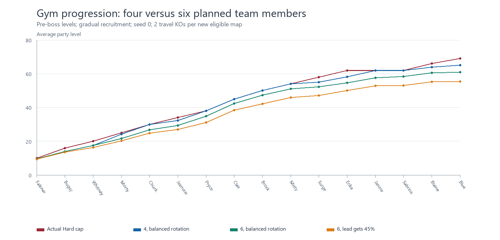
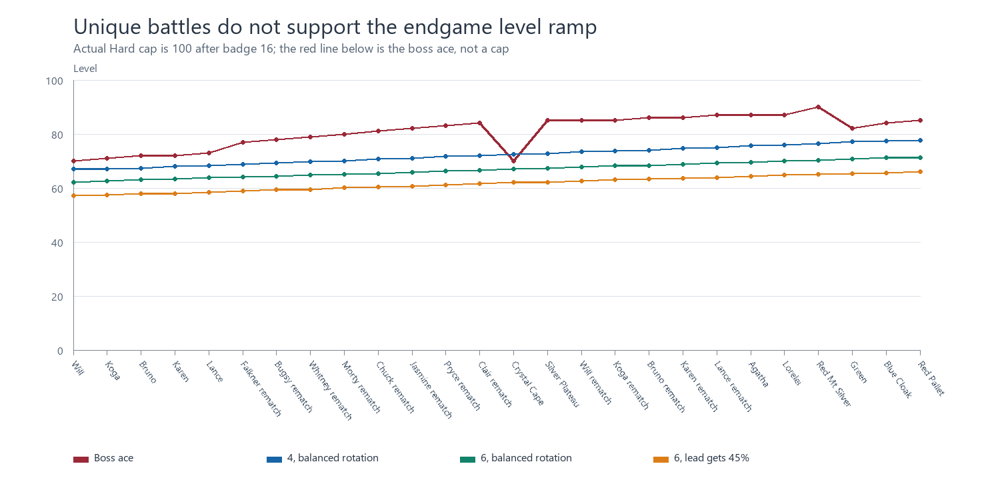
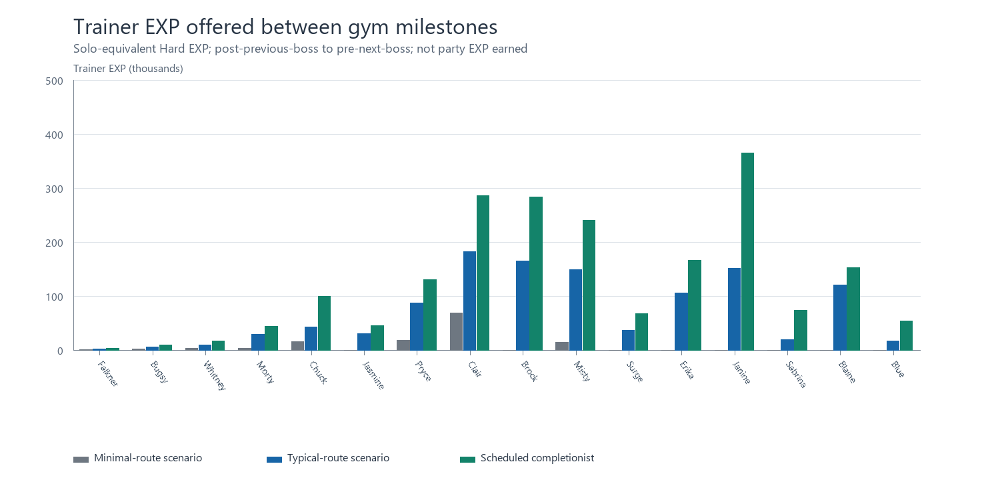
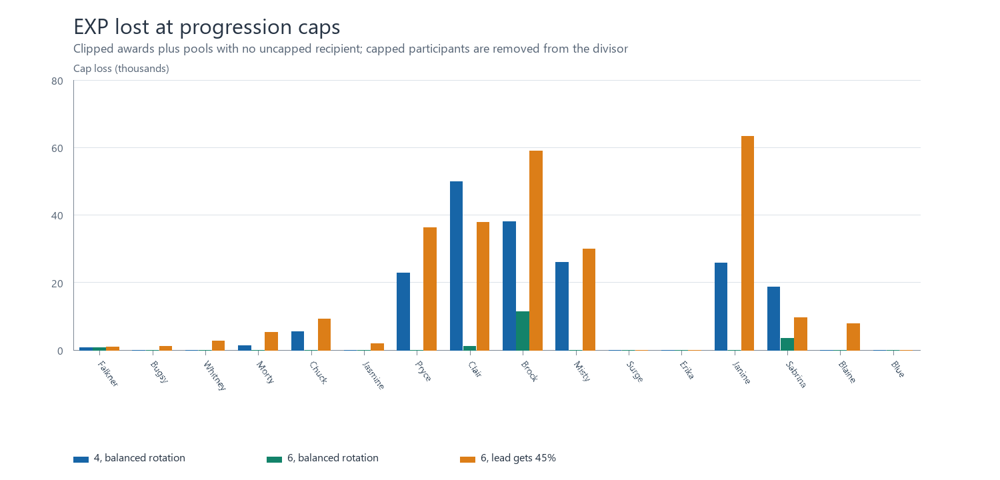

# Pokémon Crimson Crystal — Hard Mode EXP and progression audit

Snapshot: **2026-10-26**, repository commit `734cf74a1a99df149419d769c748382ade811501`. No gameplay files were changed. All generated files and code are confined to this audit directory.

## Findings and scope

**The modeled unique-battle economy does not meet the requested smooth four-to-six-Pokémon progression goal across the whole campaign.** Four-member teams generally handle Johto's EXP better. The corrected Lighthouse-after-Chuck itinerary puts four members close to Jasmine's cap; the original audit overstated this local shortage. Six-member teams are more sensitive to recruitment and participation. Kanto and especially the post-League level ramp remain short even with balanced rotation. This is an EXP-budget finding, not a claim that every underleveled team loses its battles.

In the typical-route, balanced-rotation example, four members arrive at Jasmine at **33/32/32/32** against cap 34; six arrive at **31/30/30/29/32/24**. At Blue, the six-member party is **62/61/61/61/65/56** against cap 69. Before Mt. Silver Red it is **70/71/70/70/75/65** against ace 90. Actual Hard Mode's cap after badge 16 is **100**, not Red's or any rematch leader's ace.

There is also a verified combat/progression defect independent of EXP supply: **Eusine's five-Pokémon level 38–40 team can trigger at Ecruteak's `(36, 9)` with three badges, when the player's cap is 25.** The existing ROM reaches `startbattle` with `MYSTICALMAN/EUSINE2` under that state. Extra grinding cannot raise the player's ordinary level past 25 here.

This deliverable includes a complete inventory of the relevant source definitions, map references and encounter tables, plus reproducible scenarios. It is **not an exhaustive executable proof of map reachability or the globally smallest unavoidable trainer set**. The precise casual encounter rate is unmeasured. The route model, conditional maximum, minimum-route assumptions, and incomplete movement proof are stated explicitly below. The tables must not be read as measured player telemetry or guaranteed battle outcomes.

Start with this report; consult [BOSS_CATALOG.md](BOSS_CATALOG.md), [ZONE_REVIEW.md](ZONE_REVIEW.md), [PRIORITY_FIXES.md](PRIORITY_FIXES.md), and [README.md](README.md) for the detailed teams, every map, recommendations, and rerun instructions.

**Lighthouse correction:** Jasmine blocks entry until the Cianwood Secretpotion trip. The default now visits Cianwood, defeats Chuck, then climbs the Lighthouse before Jasmine. Returning with medicine before defeating Chuck is a permitted alternative, not a required ordering. The original pre-Chuck assignment and recommendation to move Lighthouse trainers have been withdrawn. See [LIGHTHOUSE_CORRECTION.md](LIGHTHOUSE_CORRECTION.md).



## What was verified


| Item | Coverage |
|---|---|
| Species, with custom EXP yields/growth/stats/abilities | 498 |
| Trainer party definitions | 595 |
| Trainer Pokémon records | 1,822 |
| Map scripts and map headers | 406 |
| Map connections and warp edges | 1,511 |
| Trainer/loadtrainer references | 585 |
| Selected campaign encounter instances | 442 |
| Major/side boss encounter variants selected for the main starter | 63 |
| Primary campaign checkpoints | 42 |
| Grass/surf slots, all times and swarms | 2,358 |
| Map/time encounter tables, including Safari sub-tables | 374 |
| Fishing groups | 19 |
| Resolved rod/time slots | 432 |
| Headbutt/Rock Smash map slots | 416 |
| Contest slots | 22 |
| Static encounter commands / expanded scripted wild instances | 27 / 43 |
| Gift/egg commands; NPC trades | 34 / 7 |
| Custom move definitions / evolution methods | 442 / 280 |
| Simulation runs / gym-order schedules | 2928 / 432 |
| Source files fingerprinted | 2,664 |


All **585** trainer references reconcile: **439** selected/shared references, **24** mutually exclusive starter alternatives, **121** repeatable/external references, and **one unspawned script**. The unspawned script is Super Nerd Stan in Ruins of Alph Outside; it has no object or incoming script call and contributes no campaign EXP. [reference_coverage.csv](reference_coverage.csv) preserves every reference and its disposition. Party definitions without a direct map reference are listed separately; dynamic Trainer House tiers are identified rather than treated as extra encounters.

The private PyBoy cartridge checks passed **2,284 native checks**, including all six engine growth formulas at every level 1–100, every badge cap, actual EXP grants, participant division, Day Care banking, over-cap acquisition, the early Eusine script, 594 static trainer parties and all 498 species' EXP/growth bytes. CAL2 is external SRAM trainer data and is explicitly not equated to the static placeholder. The repository's existing `tools/test_league_progression.py` also passed **3,974 checks, zero failures**. The audit regression suite exercises arithmetic, caps, access, recruitment and double counting; [native_verification.json](native_verification.json) contains the native observations.

ROM SHA-256: `10a348bbf7aeb48ec8f44d36f1d482962b329f99b988143b28d54decd13fbb82`. The relevant compiled values match the source. A fresh whole-ROM reproducible build was not attempted, and the user's saves were not opened or saved by the audit. Native presentation patches exist only in a private emulator image.

## Actual EXP mechanics

Source authority: [engine/battle/core.asm:7313](../../../engine/battle/core.asm#L7313), [engine/battle/core.asm:7738](../../../engine/battle/core.asm#L7738), [engine/battle/core.asm:7793](../../../engine/battle/core.asm#L7793), and [engine/pokemon/experience.asm:41](../../../engine/pokemon/experience.asm#L41).

For base EXP yield `b`, defeated Pokémon level `L`, and `n` **eligible, conscious, uncapped participants in that pass**, the ordinary Hard trainer award to each eligible participant is:

```text
base_for_pass = b                         # no EXP Share holder
base_for_pass = floor(b / 2)              # EXP Share: each of two passes
split_base = floor(base_for_pass / max(n, 1))
award = floor(split_base * L / 7)
award = award + floor(award / 2)          # only if recipient OT ID differs
award = min(65535, 2 * award)             # Hard trainer battles
award = award + floor(award / 2)          # only if recipient holds Lucky Egg
```

Normal trainer battles use `award + floor(award/2)` instead of doubling. Wild KOs omit the trainer boost. The player Pokémon's level does **not** scale the award; its level only affects cap eligibility. This is a modified Gen 2-style base-yield system, with a custom Hard multiplier and cap handling, not a Gen 5 level-relative catch-up formula.

The order of floors matters. With `b=127`, `L=50`, solo Hard EXP is 1,814. Three uncapped participants get **600 each**, not `1814//3=604`. One active participant and one EXP Share holder get 900 each. Two active participants plus one holder get 442 + 442 + 900. The simulator reproduces these operations, and actual native grant tests agree.


| Mechanic | Implemented behavior |
|---|---|
| Trainer bonus | Hard ×2; Normal ×1.5 with integer floors. Wild KOs are not doubled. |
| Participation / switches | Only conscious participants in that opposing Pokémon’s battle receive the participant pass. Switching increases the divisor; it does not duplicate full EXP. |
| EXP Share | Held item, not an automatic party-wide feature. If at least one conscious holder exists, base yields are halved before the participant and holder passes. Each pass divides separately. An active holder can receive both passes. |
| Capped participants | Excluded from the divisor. Their presence does not dilute another uncapped participant’s share. A wholly capped pass is lost; the other EXP Share half is not reallocated to the other pass. |
| Fainted members | No EXP. All baseline runs assume selected recipients survive; actual fainting can widen disparities. |
| Catching | No battle EXP for a catch. The caught Pokémon brings its own starting EXP at its encountered level. |
| Trades | Different OT ID gives ×1.5, before the trainer multiplier. NPC trades use the surrendered Pokémon’s level. |
| Lucky Egg | Held Lucky Egg gives ×1.5 after the trainer boost; Chansey’s custom base data lists it as a held item. It cannot occupy the same item slot as EXP Share. Neither bonus is assumed in the baseline. |
| Hard cap | Indexed by TOTAL badge count, not the next leader’s identity. Cap is 100 after badge 16. |
| At / crossing cap | Already capped Pokémon get no battle EXP. A grant crossing the cap is clipped to exactly that growth curve’s EXP at the cap. The excess is discarded, not restored by another badge. |
| Stat EXP | Credited before the level-cap check. It is distinct from level EXP and is not part of the progression totals. |
| Rare Candy | Refreshes the cap and refuses a Pokémon already at/above it. It does not bypass the cap. |
| Day Care exception | DayCareStep still adds EXP per counted step. Withdrawal level calculation is capped, but the underlying EXP is banked. Native checks show it becomes usable at a higher cap. No Day Care walking EXP is assumed. |
| Acquisition exception | TryAddMonToParty initializes the encountered/gift level and EXP without reducing it to the Hard cap. A native level-30 acquisition retained level/EXP at a level-16 cap. Own-OT Pokémon bypass the traded obedience check. |
| Excluded battle sources | Link and Battle Tower return without awarding battle EXP. Capture-only Safari/contest play is not ordinary KO training. Roaming beast battles are disabled; beasts are static encounters. |


Cap clipping and skipping: [engine/battle/core.asm:7410](../../../engine/battle/core.asm#L7410), [engine/battle/core.asm:7530](../../../engine/battle/core.asm#L7530). Rare Candy: [engine/items/item_effects.asm:1491](../../../engine/items/item_effects.asm#L1491). Day Care: [engine/events/happiness_egg.asm:140](../../../engine/events/happiness_egg.asm#L140) and `engine/pokemon/breedmon_level_growth.asm`. Acquisition: [engine/pokemon/move_mon.asm:151](../../../engine/pokemon/move_mon.asm#L151); own-OT obedience: [engine/battle/effect_commands.asm:781](../../../engine/battle/effect_commands.asm#L781). Fishing and surfing require their actual runtime rules, not just the table levels.

The battle EXP clamp still applies when a withdrawn Day Care Pokémon resumes gaining EXP; banked values above a newly active cap can be clipped by that subsequent grant. This is not a permanent reserve automatically restored in full at each badge.

### Growth curves

`CalcExpAtLevel` evaluates `floor(a*n³/b) + c*n² + d*n - e`, with level 1 explicitly zero. All 280 extracted evolution methods preserve the growth curve; the audit found no cross-curve evolution to complicate EXP preservation.


| Curve | Species using it | EXP at 25 | at 50 | at 70 | at 90 | at 100 |
|---|---|---|---|---|---|---|
| Medium Fast | 222 | 15,625 | 125,000 | 343,000 | 729,000 | 1,000,000 |
| Slightly Fast | 0 | 17,938 | 118,720 | 306,220 | 627,720 | 849,970 |
| Slightly Slow | 0 | 24,148 | 143,680 | 355,180 | 708,680 | 949,930 |
| Medium Slow | 150 | 11,735 | 117,360 | 344,960 | 762,160 | 1,059,860 |
| Fast | 35 | 12,500 | 100,000 | 274,400 | 583,200 | 800,000 |
| Slow | 91 | 19,531 | 156,250 | 428,750 | 911,250 | 1,250,000 |


Slightly Fast and Slightly Slow are engine-supported polynomial curves but **no current species uses them**. Erratic and Fluctuating are not implemented. The realistic cohorts use only Fast, Medium Fast, Medium Slow and Slow. [growth_curve_sensitivity.csv](growth_curve_sensitivity.csv) isolates these four active curves. The per-Pokémon records use actual accumulated EXP, not an average-level conversion.

## Progression and gates

The default itinerary is Falkner → Bugsy → Whitney → Morty → Chuck → Jasmine → Pryce → Clair/shrine → Brock → Misty → Surge → Erika/Janine/Sabrina → Blaine → Blue → first League → Johto rematches → Cape Crystal → League rematch → Agatha/Lorelei → Mt. Silver Red → Green → Blue Cloak → Pallet Red. This is a declared visit order; several events permit different timings.

The exact cap table is **10, 16, 20, 25, 30, 34, 38, 45, 50, 54, 58, 62, 62, 62, 66, 69**, then 100. Kanto's middle three gyms share a cap tier, but other permitted departures from the suggested order can put a stronger fixed team under an earlier, lower cap.


| Progression point | Verified requirement / consequence |
|---|---|
| Violet → Azalea | Route 32 story blocker checks Falkner and the aide egg; Kurt and Slowpoke Well precede Bugsy. Sprout Tower is useful optional EXP, not a prerequisite for Falkner. |
| Ecruteak | Whitney/Floria/Squirtbottle opens Sudowoodo. Burned Tower’s beast-release story opens Morty. ALL EIGHT Kimono Girl flags are required for HM Surf, and Fog Badge is required to use Surf. |
| Western Johto | Routes 38/39 are accessible before Morty, but Jasmine blocks the Lighthouse entrance until the Cianwood Secretpotion trip. Default: Chuck, then Lighthouse, then Jasmine. The medicine trip does not itself require Chuck’s badge; returning earlier is tested separately. |
| Mahogany | The Route 42 fisherman and three approach triggers check EVENT_BEAT_JASMINE. The declared corridor model therefore requires Jasmine before the Mahogany/Pryce leg; Chuck can move around that dependency. |
| Blackthorn / Clair | Rocket Hideout opens the eastward road; Radio Tower clearance removes Blackthorn’s gym blocker. Clair withholds Rising Badge until the Dragon Shrine trial. Den approach EXP remains capped at 45; the model raises the cap only after that approach. |
| Kanto entry | Eight Johto badges allow the eastward Kanto exit of VictoryRoadGate. Restored Viridian Forest and Pewter are on this approach. The northern Victory Road guards still require ALL SIXTEEN badges. |
| Kanto flexibility | Brock and Misty do not have extra gym-script badge checks. Route 5 opening requires Misty plus the returned Machine Part. Saffron’s gates have a separate shared drink requirement. Central leaders have fixed teams, not badge-scaled teams. |
| Southern Kanto | CheckSouthernKantoAccessScript requires all eight Johto badges plus Boulder, Cascade, Thunder, Rainbow, Marsh and Soul. Both the Viridian southern road and Fuchsia shoreline use this rule. |
| Blue | At least fifteen total badges. Blue AND all three ordinary Viridian Gym trainers share EVENT_VIRIDIAN_GYM_BLUE; the model does not award their EXP on first entering Kanto. |
| First Elite Four | Only after sixteen badges. First-team aces are 70/71/72/72/73; there is no post-Johto eight-badge League in this implementation. |
| Johto rematches | First Hall of Fame unlocks Falkner; each previous Johto rematch unlocks the next, finishing with Clair. These eight rematches are one-time event-gated fights. |
| League rematch | EVENT_BEAT_CLAIR_REMATCH removes the Route 23 re-entry block and selects rematch teams. Silver’s Plateau ambush also requires the Mt. Moon rival event. |
| Mt. Silver | Oak requires sixteen badges, first Hall of Fame, Clair rematch AND EVENT_BEAT_CRYSTAL_CERULEAN_CAPE. The second League victory is NOT required. Agatha and Lorelei precede cave entry, with a heal between them. |
| Final chain | Lance’s rematch clears EVENT_GREEN_IN_ROUTE20. Green unlocks Blue Cloak; Blue Cloak unlocks Pallet Red. Mt. Silver Red is NOT a prerequisite for this chain. The legal Green-first alternative is simulated separately. |
| Cape Crystal / cave | Erika’s badge enables the Mew/Cape event. Crystal’s team reaches 70 even if the badge cap is 62. Cerulean Cave requires caught Mew AND Mew in the party; its wild levels are 55–62, with static Mewtwo 70. |
| Optional wings / islands | Tin Tower’s upper stairs need Rainbow Wing; its NPC visibility includes eight Johto badges and the beast check. Lugia needs Silver Wing. Route 19’s elemental islands additionally need the Elemental Sphere. These are not assumed free early EXP. |


Gate sources: `engine/events/league_progression.asm`; `maps/VictoryRoadGate.asm`; `maps/Route5.asm`; `engine/events/saffron_gates.asm`; `maps/Route19.asm`; `maps/ViridianGym.asm`; `maps/OaksLab.asm`; `maps/Route23.asm`; `maps/LancesRoom.asm`; `maps/Route20.asm`; `maps/CinnabarIsland.asm`; `maps/PalletTown.asm`; `maps/DragonShrine.asm`. Every extracted condition, with a line reference, is in [access_conditions.csv](access_conditions.csv). All 1,511 links are in [map_edges.csv](map_edges.csv).

### Exact primary teams and caps

Levels below are extracted, not inferred from a boss name. Species, every move, item, selected ability, custom stats and Hard stat EXP for all 63 selected major/side boss encounters are in [BOSS_CATALOG.md](BOSS_CATALOG.md) and [boss_teams.csv](boss_teams.csv). Alternate starters remain in the complete trainer database.


| Milestone | Actual cap | Party (species:level) | Ace | Party source |
|---|---|---|---|---|
| Falkner | 10 | HOOTHOOT:8, FLETCHLING:9, PIDGEOTTO:10 | 10 | [data/trainers/parties.asm:20](../../../data/trainers/parties.asm#L20) |
| Bugsy | 16 | PINECO:14, JOLTIK:15, SCYTHER:16 | 16 | [data/trainers/parties.asm:137](../../../data/trainers/parties.asm#L137) |
| Whitney | 20 | CLEFAIRY:18, AIPOM:19, BUNEARY:19, MILTANK:20 | 20 | [data/trainers/parties.asm:76](../../../data/trainers/parties.asm#L76) |
| Morty | 25 | GOLETT:23, MISDREAVUS:24, DRIFLOON:24, GENGAR:25 | 25 | [data/trainers/parties.asm:193](../../../data/trainers/parties.asm#L193) |
| Chuck | 30 | HITMONTOP:28, GURDURR:28, BRELOOM:29, SCRAGGY:29, POLIWRATH:30 | 30 | [data/trainers/parties.asm:391](../../../data/trainers/parties.asm#L391) |
| Jasmine | 34 | SKARMORY:31, LAIRON:31, MAGNETON:32, TINKATUFF:33, STEELIX:34 | 34 | [data/trainers/parties.asm:325](../../../data/trainers/parties.asm#L325) |
| Pryce | 38 | NINETALES_ALOLAN:35, DEWGONG:36, CETITAN:36, GLACEON:37, ABOMASNOW:37, MAMOSWINE:38 | 38 | [data/trainers/parties.asm:254](../../../data/trainers/parties.asm#L254) |
| Clair | 45 | DRAGONAIR:42, NOIVERN:43, FLYGON:43, ALTARIA:44, TYRANTRUM:44, KINGDRA:45 | 45 | [data/trainers/parties.asm:457](../../../data/trainers/parties.asm#L457) |
| Brock | 50 | AERODACTYL:47, CRADILY:48, STEELIX:48, BASTIODON:49, ARMALDO:49, GOLEM:50 | 50 | [data/trainers/parties.asm:1027](../../../data/trainers/parties.asm#L1027) |
| Misty | 54 | MILOTIC:51, WALREIN:52, GYARADOS:52, AZUMARILL:53, LANTURN:53, STARMIE:54 | 54 | [data/trainers/parties.asm:1064](../../../data/trainers/parties.asm#L1064) |
| Surge | 58 | MAGNEZONE:55, ELECTIVIRE:56, VIKAVOLT:56, JOLTEON:57, AMPHAROS:57, RAICHU:58 | 58 | [data/trainers/parties.asm:1101](../../../data/trainers/parties.asm#L1101) |
| Erika | 62 | LUDICOLO:59, JUMPLUFF:60, VILEPLUME:60, VICTREEBEL:61, EXEGGUTOR:61, TSAREENA:62 | 62 | [data/trainers/parties.asm:1184](../../../data/trainers/parties.asm#L1184) |
| Janine | 62 | TOXAPEX:59, VENOMOTH:60, SEVIPER:60, OVERQWIL:61, ARIADOS:61, CROBAT:62 | 62 | [data/trainers/parties.asm:2107](../../../data/trainers/parties.asm#L2107) |
| Sabrina | 62 | MESMERIA:59, GARDEVOIR:60, FARIGIRAF:60, HYPNO:61, WOBBUFFET:61, ALAKAZAM:62 | 62 | [data/trainers/parties.asm:3344](../../../data/trainers/parties.asm#L3344) |
| Blaine | 66 | NINETALES:63, ARCANINE:64, ARMAROUGE:64, TORKOAL:65, RAPIDASH:65, MAGMORTAR:66 | 66 | [data/trainers/parties.asm:4679](../../../data/trainers/parties.asm#L4679) |
| Blue | 69 | PIDGEOT:66, RHYPERIOR:67, GYARADOS:67, ARCANINE:68, SCIZOR:68, ELECTIVIRE:69 | 69 | [data/trainers/parties.asm:6577](../../../data/trainers/parties.asm#L6577) |
| Will | 100 | XATU:67, FARIGIRAF:68, GALLADE:68, SLOWKING:69, GRUMPIG:69, WYRDEER:70 | 70 | [data/trainers/parties.asm:530](../../../data/trainers/parties.asm#L530) |
| Koga | 100 | GLIMMORA:68, MUK_ALOLAN:69, SCOLIPEDE:69, TENTACRUEL:70, SALAZZLE:70, CROBAT:71 | 71 | [data/trainers/parties.asm:885](../../../data/trainers/parties.asm#L885) |
| Bruno | 100 | CONKELDURR:69, HITMONTOP:70, LUCARIO:70, TOXICROAK:71, ANNIHILAPE:71, MACHAMP:72 | 72 | [data/trainers/parties.asm:744](../../../data/trainers/parties.asm#L744) |
| Karen | 100 | UMBREON:69, HONCHKROW:70, WEAVILE:70, GRIMMSNARL:71, HOUNDOOM:71, KINGAMBIT:72 | 72 | [data/trainers/parties.asm:814](../../../data/trainers/parties.asm#L814) |
| Lance | 100 | HAXORUS:70, ARCHALUDON:71, SALAMENCE:71, DRAGAPULT:72, BAXCALIBUR:72, DRAGONITE:73 | 73 | [data/trainers/parties.asm:956](../../../data/trainers/parties.asm#L956) |
| Falkner rematch | 100 | SKARMORY:75, NOCTOWL:75, ARCHEOPS:76, TALONFLAME:76, HONCHKROW:77, PIDGEOT:77 | 77 | [data/trainers/parties.asm:39](../../../data/trainers/parties.asm#L39) |
| Bugsy rematch | 100 | FORRETRESS:76, VIKAVOLT:76, HERACROSS:77, GOLISOPOD:77, VOLCARONA:78, SCIZOR:78 | 78 | [data/trainers/parties.asm:156](../../../data/trainers/parties.asm#L156) |
| Whitney rematch | 100 | BLISSEY:77, AMBIPOM:77, LOPUNNY:78, URSALUNA:78, SNORLAX:79, MILTANK:79 | 79 | [data/trainers/parties.asm:100](../../../data/trainers/parties.asm#L100) |
| Morty rematch | 100 | MISMAGIUS:78, DUSKNOIR:78, MIMIKYU:79, CHANDELURE:79, DRAGAPULT:80, GENGAR:80 | 80 | [data/trainers/parties.asm:217](../../../data/trainers/parties.asm#L217) |
| Chuck rematch | 100 | MACHAMP:79, CONKELDURR:79, GALLADE:80, SIRFETCH_D:80, ANNIHILAPE:81, POLIWRATH:81 | 81 | [data/trainers/parties.asm:420](../../../data/trainers/parties.asm#L420) |
| Jasmine rematch | 100 | MAGNEZONE:80, CORVIKNIGHT:80, EXCADRILL:81, LUCARIO:81, TINKATON:82, STEELIX:82 | 82 | [data/trainers/parties.asm:354](../../../data/trainers/parties.asm#L354) |
| Pryce rematch | 100 | NINETALES_ALOLAN:81, CLOYSTER:81, GLACEON:82, WEAVILE:82, LAPRAS:83, MAMOSWINE:83 | 83 | [data/trainers/parties.asm:288](../../../data/trainers/parties.asm#L288) |
| Clair rematch | 100 | ALTARIA:82, NOIVERN:82, ARCHALUDON:83, HAXORUS:83, SALAMENCE:84, KINGDRA:84 | 84 | [data/trainers/parties.asm:491](../../../data/trainers/parties.asm#L491) |
| Crystal Cape | 100 | MEGANIUM:70, HYDRAPPLE:68, TYRANITAR:69, MAROWAK:69, XATU:68, LANTURN:68 | 70 | [data/trainers/parties.asm:8412](../../../data/trainers/parties.asm#L8412) |
| Silver Plateau | 100 | CROBAT:82, MAGNEZONE:83, SLOWKING_GALARIAN:83, WEAVILE:83, CERULEDGE:83, FERALIGATR:85 | 85 | [data/trainers/parties.asm:8100](../../../data/trainers/parties.asm#L8100) |
| Will rematch | 100 | XATU:83, FARIGIRAF:84, GALLADE:84, SLOWKING:85, GRUMPIG:85, ESPATHRA:85 | 85 | [data/trainers/parties.asm:564](../../../data/trainers/parties.asm#L564) |
| Koga rematch | 100 | GLIMMORA:83, MUK_ALOLAN:84, SCOLIPEDE:84, TENTACRUEL:85, SALAZZLE:85, CROBAT:85 | 85 | [data/trainers/parties.asm:919](../../../data/trainers/parties.asm#L919) |
| Bruno rematch | 100 | CONKELDURR:84, HITMONTOP:85, LUCARIO:85, TOXICROAK:86, ANNIHILAPE:86, MACHAMP:86 | 86 | [data/trainers/parties.asm:778](../../../data/trainers/parties.asm#L778) |
| Karen rematch | 100 | UMBREON:84, HONCHKROW:85, WEAVILE:85, GRIMMSNARL:86, HOUNDOOM:86, KINGAMBIT:86 | 86 | [data/trainers/parties.asm:848](../../../data/trainers/parties.asm#L848) |
| Lance rematch | 100 | HYDREIGON:85, ARCHALUDON:86, SALAMENCE:86, DRAGAPULT:87, BAXCALIBUR:87, DRAGONITE:87 | 87 | [data/trainers/parties.asm:990](../../../data/trainers/parties.asm#L990) |
| Agatha | 100 | GENGAR:85, MISDREAVUS:86, ARBOK:86, CROBAT:87, HAUNTER:87, GENGAR:87 | 87 | [data/trainers/parties.asm:7099](../../../data/trainers/parties.asm#L7099) |
| Lorelei | 100 | DEWGONG:85, CLOYSTER:86, SLOWBRO:86, MESMERIA:87, LAPRAS:87, GLACEON:87 | 87 | [data/trainers/parties.asm:7136](../../../data/trainers/parties.asm#L7136) |
| Red Mt Silver | 100 | PIKACHU:88, ESPEON:89, SNORLAX:89, VENUSAUR:90, CHARIZARD:90, BLASTOISE:90 | 90 | [data/trainers/parties.asm:6540](../../../data/trainers/parties.asm#L6540) |
| Green | 100 | WIGGLYTUFF:80, UMBREON:81, NIDOQUEEN:81, MESMERIA:82, LANTURN:82, VENUSAUR:82 | 82 | [data/trainers/parties.asm:7247](../../../data/trainers/parties.asm#L7247) |
| Blue Cloak | 100 | PIDGEOT:82, SCIZOR:83, RHYPERIOR:83, EXEGGUTOR:84, ELECTIVIRE:84, BLASTOISE:84 | 84 | [data/trainers/parties.asm:7210](../../../data/trainers/parties.asm#L7210) |
| Red Pallet | 100 | PIKACHU:83, SNORLAX:84, ESPEON:84, LAPRAS:85, AERODACTYL:85, CHARIZARD:85 | 85 | [data/trainers/parties.asm:7173](../../../data/trainers/parties.asm#L7173) |


The final chain’s aces are **Green 82 → Blue Cloak 84 → Pallet Red 85**, below League-rematch Lance 87 and Mt. Silver Red 90. Do not invent a 95–100 superboss tier from their names. Aces and level caps are different quantities.

## Simulation assumptions

Two staggered, mixed-growth cohorts were run. The principal cohort is Cyndaquil 5 (starter), Rattata 4 (Route 29), Mareep 4 (Route 30), Zubat 10 (Union Cave), Jigglypuff 17 (Route 34), and Growlithe 11 (Route 36). Prefixes of this list produce team sizes 1–6. Thus the planned six-member team has **3 active members at Falkner, 4 at Bugsy, 5 at Whitney, and 6 by Morty**, not six level-5 Pokémon at the start. Species names in the EXP logs denote the recruited line; evolution does not change these lines’ growth rates. Combat analysis uses the actual evolution/learnset data, not a level-70 unevolved-starter battle assumption.

The alternative cohort is Chikorita, Hoothoot, Hoppip, Aron, Abra and Snubbull at the source-supported join levels/maps in `model.py`. The cohorts are illustrative legitimate choices, not an optimized battle team or an observed popularity sample. Chosen catches are assumed obtained without bonus KO EXP for the catch. Search encounters, money, catch success, healing time and travel distance are not simulated.


| Playstyle | Operational assumption |
|---|---|
| Minimal-route | Only the curated required/story set, needed recruitment detours and five obstacle KOs; no random wild KOs, candy or optional side-area trainer sweep. This is NOT a proven globally minimal path. Kimono Girls are deferred until Surf is needed after Morty. |
| Typical casual (main baseline) | 70% of ordinary trainers on visited main maps. Optional maps are visited at a declared 35% rate, then 65% of optional battles there. Optional event branches on a visited main map use 65%. These are seeded scenario drivers, not measured probabilities. |
| Thorough | 95% of main/optional ordinary battles and almost all side areas, without repeated training loops. |
| Completionist | Every modeled eligible unique trainer in the scheduled itinerary, all five finite security-camera pairs and all 22 finite floor traps. Later repeatable ship passengers, phone repeats and CAL are separate. This is the itinerary’s maximum, not a theorem about every early-access shortcut. |
| Efficient Hard player | 85% of ordinary battles, more optional areas (65%), always feeding the lowest-level uncapped member. This tests informed rotation; it does not assume a typical player knows it. |


Eight participation policies are separate: casual lead share 45%; equal KO rotation; all members switch into each enemy; lead share 70%; two primaries take 80% combined; lowest-level rotation; switch training with lead + lowest; and one EXP Share holder with a main battler. The efficient playstyle explicitly forces lowest-level rotation regardless of the nominal policy column. All-participant switching is an optimistic mechanical test: Set mode and incoming damage can make it impractical.

The main random-wild driver is **2 KOs per newly visited encounter-bearing map**. Sensitivities use **0 / 2 / 5**, over 20 fixed seeds for typical four- and six-member teams and two distribution policies. Day tables are used; all morning/night tables are retained in the source database, but no literal clock itinerary is claimed. Surf-only EXP is blocked before Morty. Western Ruins grass and Route 34’s beach are treated as later Surf content. Safari and contest catches grant no KO training EXP. Revisited maps do not generate another automatic travel allotment.

Five story obstacles are KO’d in the baseline: Sudowoodo, red Gyarados and three Electrode. Capturing them instead removes their wild awards; the scripted wild database exposes the precise totals. Other static rare Pokémon are treated as captures with zero battle EXP, not silently turned into EXP farms. The optional 22 Rocket floor traps are expanded by their distinct event flags; typical exposure is a stated 10% per trap, thorough 50%, completionist all. The five cameras are separate finite encounters, not one endlessly credited grunt pair.

Every selected battle is assumed won, with intended recipients conscious. There is no automatic grinding between checkpoints. In particular, later results are **not** the levels of a player who first filled an earlier deficit: they show deficits carried forward. Difficulty does not follow from EXP alone.

## Main results: all primary milestones

Each table uses one playstyle at a time. “Min/Typ/Max EXP” are solo-equivalent TRAINER offers from the minimal-route, typical-route and scheduled-completionist cases; they are not summed together and are not EXP automatically earned by each party member. “Start6” is the average after the previous primary boss, before the next route segment. A boss’s own award is applied only AFTER its row. Between consecutive League/rematch bosses the new-route EXP may be zero because the previous boss award is already in Start6.

Team columns are individual levels using that playstyle’s casual participation policy (45% lead); Efficient uses lowest-level rotation. More evenly distributed comparison tables follow. Post-badge-16 “target” means boss ace; the actual cap remains 100. “KOs6” is an independent, balanced-training estimate to bring the whole unground team to that target, not a minimum required to win and not a count to add to other rows.


### Minimal


| Milestone | Cap/target | Start6 | Min/Typ/Max EXP | Team 3 | Team 4 | Team 5 | Team 6 | Shortfall6 | KOs6 | Rating6 |
|---|---|---|---|---|---|---|---|---|---|---|
| Falkner | 10/10 | 5.0 | 454/2,152/3,260 | 10/4/4 | 10/4/4 | 10/4/4 | 10/4/4 | 1,400 | 40 | Poor |
| Bugsy | 16/16 | 7.3 | 2,370/5,636/9,078 | 13/10/11 | 13/9/12/10 | 13/9/12/10 | 13/9/12/10 | 8,910 | 91 | Poor |
| Whitney | 20/20 | 11.8 | 2,786/9,476/16,606 | 17/11/14 | 17/10/12/13 | 17/10/12/13/17 | 17/10/12/13/17 | 21,290 | 163 | Poor |
| Morty | 25/25 | 14.6 | 2,792/28,708/44,080 | 20/13/18 | 20/11/17/13 | 20/11/13/16/17 | 20/11/13/14/18/11 | 67,523 | 277 | Poor |
| Chuck | 30/30 | 15.2 | 15,658/42,730/99,754 | 27/15/24 | 27/14/21/17 | 27/11/16/20/20 | 27/11/16/15/21/15 | 114,724 | 267 | Poor |
| Jasmine | 34/34 | 18.7 | 0/30,566/44,732 | 28/18/25 | 28/14/23/19 | 28/12/19/20/20 | 29/14/17/15/22/15 | 180,697 | 408 | Poor |
| Pryce | 38/38 | 19.5 | 18,128/86,840/130,662 | 35/21/28 | 35/18/24/23 | 35/12/23/22/23 | 35/14/22/17/24/18 | 245,378 | 406 | Poor |
| Clair | 45/45 | 22.5 | 68,128/182,010/285,682 | 43/31/36 | 43/29/31/28 | 43/23/28/29/29 | 43/21/28/20/31/23 | 383,165 | 402 | Poor |
| Brock | 50/50 | 28.3 | 0/164,442/282,978 | 44/31/37 | 44/29/31/30 | 44/23/28/31/29 | 44/21/28/20/32/25 | 573,489 | 601 | Poor |
| Misty | 54/54 | 29.5 | 14,474/149,300/240,438 | 46/33/40 | 46/30/33/33 | 46/26/29/33/31 | 46/24/28/22/36/25 | 741,098 | 772 | Poor |
| Surge | 58/58 | 31.2 | 0/35,902/67,482 | 47/35/41 | 47/32/34/34 | 47/29/29/34/32 | 47/27/28/22/37/26 | 953,512 | 993 | Poor |
| Erika | 62/62 | 31.8 | 0/105,606/166,254 | 49/35/43 | 49/32/35/35 | 49/29/29/36/32 | 48/27/28/22/40/26 | 1,195,795 | 1246 | Poor |
| Janine | 62/62 | 33.2 | 0/151,818/365,266 | 50/37/44 | 50/35/36/36 | 50/31/29/37/33 | 49/30/28/24/40/28 | 1,172,025 | 1220 | Poor |
| Sabrina | 62/62 | 34.3 | 0/18,752/73,336 | 50/39/46 | 50/36/38/37 | 50/31/32/39/35 | 49/30/29/26/41/31 | 1,155,171 | 1204 | Poor |
| Blaine | 66/66 | 35.0 | 0/120,864/151,918 | 51/40/47 | 51/36/39/39 | 51/31/33/39/37 | 51/30/29/27/42/31 | 1,435,957 | 1494 | Poor |
| Blue | 69/69 | 35.7 | 0/16,900/53,912 | 53/40/48 | 53/36/40/41 | 53/31/33/39/39 | 53/30/29/27/43/32 | 1,666,424 | 1732 | Poor |
| Will | 100/70 | 36.5 | 25,230/68,098/105,250 | 54/40/52 | 54/37/43/44 | 54/33/33/43/42 | 54/30/31/27/47/36 | 1,705,477 | 1774 | Poor |
| Koga | 100/71 | 37.8 | 0/0/0 | 55/40/54 | 55/37/43/46 | 55/33/33/44/44 | 55/30/31/27/47/37 | 1,774,653 | 1845 | Poor |
| Bruno | 100/72 | 38.5 | 0/0/0 | 57/41/54 | 57/38/43/46 | 57/34/33/44/44 | 57/31/31/27/47/38 | 1,846,035 | 1921 | Poor |
| Karen | 100/72 | 39.5 | 0/0/0 | 58/43/55 | 58/38/44/47 | 58/34/36/44/46 | 57/32/32/30/47/39 | 1,820,837 | 1894 | Poor |
| Lance | 100/73 | 40.3 | 0/0/0 | 59/44/56 | 59/39/45/48 | 59/34/37/45/47 | 58/32/33/30/50/39 | 1,893,685 | 1967 | Poor |
| Falkner rematch | 100/77 | 41.2 | 0/0/0 | 60/45/57 | 60/40/45/50 | 60/36/37/45/49 | 59/34/33/30/51/40 | 2,280,953 | 2371 | Poor |
| Bugsy rematch | 100/78 | 41.8 | 0/0/0 | 61/46/58 | 61/42/45/51 | 61/38/37/45/50 | 60/36/33/30/51/41 | 2,369,034 | 2465 | Poor |
| Whitney rematch | 100/79 | 42.7 | 0/0/0 | 61/47/59 | 61/43/46/52 | 61/38/37/47/50 | 61/36/35/32/51/41 | 2,457,974 | 2557 | Poor |
| Morty rematch | 100/80 | 43.3 | 0/0/0 | 62/48/59 | 62/44/46/52 | 62/40/37/47/50 | 62/37/36/33/51/41 | 2,550,585 | 2652 | Poor |
| Chuck rematch | 100/81 | 44.2 | 0/0/0 | 64/49/59 | 64/46/46/52 | 64/42/37/47/50 | 64/39/37/33/51/41 | 2,641,222 | 2746 | Poor |
| Jasmine rematch | 100/82 | 44.8 | 0/0/0 | 66/51/59 | 66/47/46/52 | 66/43/39/47/50 | 65/40/39/33/51/41 | 2,732,557 | 2840 | Poor |
| Pryce rematch | 100/83 | 45.8 | 0/0/0 | 66/52/60 | 66/48/47/52 | 66/43/41/49/50 | 66/40/39/36/53/41 | 2,829,519 | 2940 | Poor |
| Clair rematch | 100/84 | 46.3 | 0/0/0 | 67/53/61 | 67/49/48/53 | 67/44/41/49/51 | 67/41/39/37/53/41 | 2,932,288 | 3045 | Poor |
| Crystal Cape | 100/70 | 47.0 | 0/0/0 | 68/54/62 | 68/49/50/53 | 68/45/43/50/51 | 67/41/41/38/54/41 | 1,351,123 | 1407 | Poor |
| Silver Plateau | 100/85 | 47.5 | 0/0/0 | 69/55/62 | 69/50/50/54 | 69/45/44/51/51 | 69/41/42/38/54/41 | 3,008,781 | 3125 | Poor |
| Will rematch | 100/85 | 48.0 | 0/0/0 | 70/55/63 | 70/50/50/54 | 70/45/44/51/52 | 70/41/42/38/54/43 | 2,976,201 | 3091 | Poor |
| Koga rematch | 100/85 | 48.3 | 0/0/0 | 72/55/63 | 72/50/50/55 | 72/45/44/51/53 | 71/41/42/38/54/44 | 2,947,787 | 3061 | Poor |
| Bruno rematch | 100/86 | 48.8 | 0/0/0 | 73/56/63 | 73/51/51/55 | 73/46/44/51/53 | 73/41/42/39/54/44 | 3,055,875 | 3174 | Poor |
| Karen rematch | 100/86 | 49.8 | 0/0/0 | 73/59/63 | 73/52/53/55 | 73/47/47/51/53 | 73/44/43/41/54/44 | 3,025,393 | 3142 | Poor |
| Lance rematch | 100/87 | 50.2 | 0/0/0 | 74/59/64 | 74/53/53/56 | 74/49/47/51/54 | 74/45/43/41/54/44 | 3,135,297 | 3256 | Poor |
| Agatha | 100/87 | 50.7 | 0/0/0 | 75/60/64 | 75/54/53/56 | 75/49/48/51/55 | 75/45/44/41/54/45 | 3,097,563 | 1204 | Poor |
| Lorelei | 100/87 | 51.2 | 0/0/0 | 76/61/64 | 76/55/53/56 | 76/49/48/51/55 | 76/46/44/41/55/45 | 3,069,421 | 1194 | Poor |
| Red Mt Silver | 100/90 | 51.8 | 0/0/0 | 77/62/65 | 77/55/54/57 | 77/49/49/52/55 | 76/46/44/43/56/46 | 3,482,081 | 1313 | Poor |
| Green | 100/82 | 52.5 | 0/0/0 | 77/62/66 | 77/55/55/58 | 77/50/49/52/56 | 77/46/45/44/56/47 | 2,344,065 | 881 | Poor |
| Blue Cloak | 100/84 | 53.0 | 0/0/0 | 78/63/66 | 78/56/56/59 | 78/51/51/52/58 | 78/47/46/44/56/47 | 2,571,832 | 966 | Poor |
| Red Pallet | 100/85 | 53.5 | 0/0/0 | 79/63/67 | 79/56/56/59 | 79/51/51/52/58 | 79/48/46/44/57/47 | 2,672,607 | 1003 | Poor |

### Typical


| Milestone | Cap/target | Start6 | Min/Typ/Max EXP | Team 3 | Team 4 | Team 5 | Team 6 | Shortfall6 | KOs6 | Rating6 |
|---|---|---|---|---|---|---|---|---|---|---|
| Falkner | 10/10 | 5.0 | 454/2,152/3,260 | 10/8/10 | 10/8/10 | 10/8/10 | 10/8/10 | 294 | 10 | Excellent |
| Bugsy | 16/16 | 9.3 | 2,370/5,636/9,078 | 16/13/15 | 16/12/15/11 | 16/12/15/11 | 16/12/15/11 | 5,023 | 51 | Needs attention |
| Whitney | 20/20 | 13.5 | 2,786/9,476/16,606 | 20/16/19 | 20/15/17/14 | 20/13/17/14/17 | 20/13/17/14/17 | 13,740 | 107 | Good |
| Morty | 25/25 | 16.6 | 2,792/28,708/44,080 | 25/22/25 | 25/21/23/23 | 25/19/20/23/22 | 25/19/19/19/25/15 | 37,897 | 156 | Poor |
| Chuck | 30/30 | 20.5 | 15,658/42,730/99,754 | 30/28/30 | 30/26/28/30 | 30/24/23/28/30 | 30/23/22/22/30/22 | 62,403 | 148 | Poor |
| Jasmine | 34/34 | 25.0 | 0/30,566/44,732 | 34/32/32 | 34/29/31/30 | 34/26/27/30/30 | 34/25/25/25/31/22 | 104,998 | 243 | Poor |
| Pryce | 38/38 | 27.5 | 18,128/86,840/130,662 | 38/38/37 | 38/34/35/35 | 38/32/33/31/35 | 38/30/29/29/34/27 | 136,729 | 227 | Poor |
| Clair | 45/45 | 31.5 | 68,128/182,010/285,682 | 45/45/45 | 45/44/45/41 | 45/42/40/40/41 | 45/40/36/36/42/31 | 194,447 | 204 | Poor |
| Brock | 50/50 | 38.5 | 0/164,442/282,978 | 50/50/49 | 50/49/47/46 | 50/48/42/43/45 | 50/44/42/38/45/34 | 282,555 | 297 | Poor |
| Misty | 54/54 | 42.5 | 14,474/149,300/240,438 | 54/54/54 | 54/52/53/50 | 54/51/47/48/49 | 54/47/44/44/48/38 | 342,311 | 359 | Poor |
| Surge | 58/58 | 46.5 | 0/35,902/67,482 | 56/55/54 | 56/54/54/51 | 56/53/48/49/50 | 56/49/44/46/49/39 | 517,238 | 541 | Poor |
| Erika | 62/62 | 47.8 | 0/105,606/166,254 | 61/60/58 | 61/57/57/54 | 61/55/52/50/53 | 61/52/47/47/51/43 | 649,799 | 679 | Poor |
| Janine | 62/62 | 50.7 | 0/151,818/365,266 | 62/62/62 | 62/59/61/58 | 62/57/54/53/58 | 62/53/50/51/54/47 | 533,293 | 492 | Poor |
| Sabrina | 62/62 | 52.8 | 0/18,752/73,336 | 62/62/62 | 62/59/62/59 | 62/57/55/55/59 | 62/53/50/52/54/47 | 516,323 | 477 | Poor |
| Blaine | 66/66 | 53.3 | 0/120,864/151,918 | 66/64/65 | 66/61/63/62 | 66/59/56/56/62 | 66/55/51/53/56/50 | 690,835 | 630 | Poor |
| Blue | 69/69 | 55.5 | 0/16,900/53,912 | 66/65/65 | 66/63/63/62 | 66/60/56/56/63 | 66/56/51/54/56/50 | 911,134 | 841 | Poor |
| Will | 100/70 | 56.0 | 25,230/68,098/105,250 | 69/68/67 | 69/64/66/63 | 69/61/58/58/64 | 69/58/52/56/57/51 | 904,385 | 835 | Poor |
| Koga | 100/71 | 57.5 | 0/0/0 | 69/68/68 | 69/64/66/63 | 69/62/58/58/64 | 69/58/52/57/57/52 | 973,561 | 896 | Poor |
| Bruno | 100/72 | 57.8 | 0/0/0 | 69/69/68 | 69/65/67/64 | 69/62/59/58/65 | 69/58/53/57/58/52 | 1,044,943 | 961 | Poor |
| Karen | 100/72 | 58.0 | 0/0/0 | 70/69/69 | 70/65/67/65 | 70/62/59/58/66 | 70/58/53/57/58/52 | 1,019,745 | 938 | Poor |
| Lance | 100/73 | 58.5 | 0/0/0 | 71/69/70 | 71/65/68/65 | 71/62/60/59/66 | 71/58/54/57/59/52 | 1,092,593 | 1003 | Poor |
| Falkner rematch | 100/77 | 59.0 | 0/0/0 | 72/69/71 | 72/65/68/66 | 72/62/60/59/67 | 72/58/54/57/59/54 | 1,479,861 | 1350 | Poor |
| Bugsy rematch | 100/78 | 59.5 | 0/0/0 | 73/70/71 | 73/65/68/66 | 73/63/60/60/67 | 73/59/54/57/60/54 | 1,567,942 | 1426 | Poor |
| Whitney rematch | 100/79 | 59.5 | 0/0/0 | 73/70/71 | 73/66/68/67 | 73/63/60/60/68 | 73/59/54/57/60/54 | 1,656,882 | 1510 | Poor |
| Morty rematch | 100/80 | 60.2 | 0/0/0 | 74/71/72 | 74/66/69/67 | 74/63/61/60/68 | 74/59/55/58/61/54 | 1,749,493 | 1597 | Poor |
| Chuck rematch | 100/81 | 60.3 | 0/0/0 | 75/71/72 | 75/66/69/67 | 75/63/61/61/68 | 75/59/55/58/61/54 | 1,840,130 | 1681 | Poor |
| Jasmine rematch | 100/82 | 60.7 | 0/0/0 | 76/72/72 | 76/66/69/68 | 76/63/61/61/69 | 76/59/55/58/61/55 | 1,931,465 | 1764 | Poor |
| Pryce rematch | 100/83 | 61.2 | 0/0/0 | 76/73/73 | 76/67/70/68 | 76/64/62/61/69 | 76/60/56/59/61/55 | 2,028,427 | 1858 | Poor |
| Clair rematch | 100/84 | 61.5 | 0/0/0 | 77/73/73 | 77/67/70/68 | 77/64/62/61/70 | 77/60/56/59/62/55 | 2,131,196 | 1950 | Poor |
| Crystal Cape | 100/70 | 62.0 | 0/0/0 | 78/73/74 | 78/68/70/69 | 78/64/62/61/70 | 78/61/56/59/63/55 | 694,668 | 635 | Poor |
| Silver Plateau | 100/85 | 62.2 | 0/0/0 | 79/73/74 | 79/68/70/69 | 79/65/62/61/70 | 79/61/56/59/63/55 | 2,207,689 | 2013 | Poor |
| Will rematch | 100/85 | 62.7 | 0/0/0 | 79/74/74 | 79/68/71/70 | 79/65/63/61/71 | 79/61/57/60/64/55 | 2,175,109 | 1987 | Poor |
| Koga rematch | 100/85 | 63.2 | 0/0/0 | 80/75/75 | 80/68/71/70 | 80/65/63/62/71 | 80/61/57/61/64/56 | 2,146,695 | 1963 | Poor |
| Bruno rematch | 100/86 | 63.3 | 0/0/0 | 80/75/75 | 80/69/71/71 | 80/66/63/62/71 | 80/62/57/61/64/56 | 2,254,783 | 2058 | Poor |
| Karen rematch | 100/86 | 63.5 | 0/0/0 | 81/76/76 | 81/69/72/71 | 81/66/64/62/72 | 81/62/57/61/64/56 | 2,224,301 | 2030 | Poor |
| Lance rematch | 100/87 | 63.8 | 0/0/0 | 82/76/76 | 82/70/72/71 | 82/67/64/62/72 | 82/63/57/61/64/56 | 2,334,205 | 2132 | Poor |
| Agatha | 100/87 | 64.2 | 0/0/0 | 83/77/76 | 83/70/72/71 | 83/67/64/63/72 | 83/63/57/61/65/57 | 2,287,820 | 890 | Poor |
| Lorelei | 100/87 | 64.8 | 0/0/0 | 84/77/77 | 84/70/73/72 | 84/67/65/63/73 | 84/63/57/62/65/58 | 2,259,678 | 879 | Poor |
| Red Mt Silver | 100/90 | 64.8 | 0/0/0 | 85/78/77 | 85/71/73/72 | 85/68/65/63/73 | 85/63/57/63/65/58 | 2,652,228 | 997 | Poor |
| Green | 100/82 | 65.3 | 0/0/0 | 86/78/77 | 86/71/73/72 | 86/68/65/63/73 | 86/63/57/63/65/58 | 1,620,843 | 611 | Poor |
| Blue Cloak | 100/84 | 65.5 | 0/0/0 | 87/78/77 | 87/71/73/72 | 87/68/65/63/73 | 87/63/57/63/65/58 | 1,833,077 | 691 | Poor |
| Red Pallet | 100/85 | 66.0 | 0/0/0 | 88/79/78 | 88/71/74/72 | 88/68/66/64/73 | 88/63/58/64/65/58 | 1,920,353 | 722 | Poor |

### Thorough


| Milestone | Cap/target | Start6 | Min/Typ/Max EXP | Team 3 | Team 4 | Team 5 | Team 6 | Shortfall6 | KOs6 | Rating6 |
|---|---|---|---|---|---|---|---|---|---|---|
| Falkner | 10/10 | 5.0 | 454/2,152/3,260 | 10/7/10 | 10/7/10 | 10/7/10 | 10/7/10 | 538 | 15 | Excellent |
| Bugsy | 16/16 | 9.0 | 2,370/5,636/9,078 | 16/13/16 | 16/11/16/12 | 16/11/16/12 | 16/11/16/12 | 4,597 | 46 | Needs attention |
| Whitney | 20/20 | 14.2 | 2,786/9,476/16,606 | 20/18/20 | 20/17/18/18 | 20/16/17/17/19 | 20/16/17/17/19 | 8,414 | 67 | Good |
| Morty | 25/25 | 18.0 | 2,792/28,708/44,080 | 25/24/25 | 25/22/24/25 | 25/21/21/24/25 | 25/20/21/21/25/18 | 28,795 | 120 | Needs attention |
| Chuck | 30/30 | 22.0 | 15,658/42,730/99,754 | 30/30/30 | 30/30/30/29 | 30/28/30/26/30 | 30/27/28/27/28/22 | 40,075 | 87 | Good |
| Jasmine | 34/34 | 27.2 | 0/30,566/44,732 | 34/34/34 | 34/33/33/32 | 34/32/32/29/33 | 34/31/29/30/30/24 | 71,392 | 156 | Needs attention |
| Pryce | 38/38 | 29.8 | 18,128/86,840/130,662 | 38/38/38 | 38/38/38/38 | 38/38/36/35/38 | 38/37/35/33/37/29 | 68,661 | 113 | Good |
| Clair | 45/45 | 35.2 | 68,128/182,010/285,682 | 45/45/45 | 45/45/45/45 | 45/45/44/43/44 | 45/45/41/41/44/35 | 101,985 | 109 | Needs attention |
| Brock | 50/50 | 42.0 | 0/164,442/282,978 | 50/50/50 | 50/50/50/50 | 50/49/49/49/50 | 50/49/45/47/49/41 | 118,895 | 79 | Good |
| Misty | 54/54 | 47.0 | 14,474/149,300/240,438 | 54/54/54 | 54/54/54/54 | 54/53/54/54/54 | 54/52/50/52/54/45 | 140,192 | 93 | Excellent |
| Surge | 58/58 | 51.2 | 0/35,902/67,482 | 57/56/55 | 57/55/55/55 | 57/55/54/54/55 | 57/54/51/53/54/46 | 287,699 | 188 | Needs attention |
| Erika | 62/62 | 52.8 | 0/105,606/166,254 | 62/61/59 | 62/57/59/57 | 62/57/58/56/57 | 62/55/52/57/56/48 | 414,545 | 268 | Poor |
| Janine | 62/62 | 55.3 | 0/151,818/365,266 | 62/62/62 | 62/62/62/62 | 62/62/62/60/62 | 62/60/57/60/61/52 | 206,697 | 137 | Excellent |
| Sabrina | 62/62 | 59.0 | 0/18,752/73,336 | 62/62/62 | 62/62/62/62 | 62/62/62/62/62 | 62/61/58/61/62/53 | 157,009 | 104 | Excellent |
| Blaine | 66/66 | 59.7 | 0/120,864/151,918 | 66/65/65 | 66/64/64/64 | 66/64/63/63/63 | 66/63/58/64/63/55 | 316,191 | 205 | Good |
| Blue | 69/69 | 61.7 | 0/16,900/53,912 | 67/66/65 | 67/64/65/64 | 67/64/63/63/64 | 67/63/59/64/63/56 | 528,346 | 342 | Poor |
| Will | 100/70 | 62.2 | 25,230/68,098/105,250 | 70/68/68 | 70/66/66/67 | 70/66/65/64/67 | 70/65/60/64/64/57 | 511,662 | 331 | Poor |
| Koga | 100/71 | 63.5 | 0/0/0 | 71/69/68 | 71/66/66/67 | 71/66/65/64/67 | 71/65/60/64/64/57 | 573,304 | 372 | Poor |
| Bruno | 100/72 | 63.8 | 0/0/0 | 71/70/68 | 71/66/66/67 | 71/66/65/64/67 | 71/65/61/64/65/57 | 642,243 | 414 | Poor |
| Karen | 100/72 | 64.0 | 0/0/0 | 72/70/68 | 72/66/67/67 | 72/66/66/64/67 | 72/65/61/64/65/57 | 633,215 | 407 | Poor |
| Lance | 100/73 | 64.3 | 0/0/0 | 73/71/68 | 73/67/67/68 | 73/67/66/65/67 | 73/65/62/64/65/57 | 697,999 | 449 | Poor |
| Falkner rematch | 100/77 | 64.7 | 0/0/0 | 74/71/68 | 74/68/67/68 | 74/67/66/65/67 | 74/66/62/64/65/57 | 1,077,161 | 690 | Poor |
| Bugsy rematch | 100/78 | 65.0 | 0/0/0 | 75/71/69 | 75/68/67/68 | 75/67/66/65/68 | 75/66/62/64/65/58 | 1,165,242 | 748 | Poor |
| Whitney rematch | 100/79 | 65.7 | 0/0/0 | 76/71/70 | 76/68/67/69 | 76/67/66/65/69 | 76/66/62/65/66/59 | 1,254,182 | 802 | Poor |
| Morty rematch | 100/80 | 65.8 | 0/0/0 | 76/72/70 | 76/68/67/69 | 76/68/66/65/69 | 76/66/63/65/66/59 | 1,346,793 | 863 | Poor |
| Chuck rematch | 100/81 | 66.2 | 0/0/0 | 77/72/71 | 77/68/68/70 | 77/68/66/66/70 | 77/66/63/65/66/60 | 1,437,430 | 925 | Poor |
| Jasmine rematch | 100/82 | 66.3 | 0/0/0 | 77/72/73 | 77/68/69/70 | 77/68/66/67/70 | 77/66/63/66/66/60 | 1,528,765 | 983 | Poor |
| Pryce rematch | 100/83 | 66.8 | 0/0/0 | 78/72/73 | 78/69/69/71 | 78/68/66/67/71 | 78/67/63/66/66/61 | 1,625,727 | 1048 | Poor |
| Clair rematch | 100/84 | 67.0 | 0/0/0 | 79/73/74 | 79/69/69/71 | 79/69/67/67/72 | 79/67/63/66/66/61 | 1,728,496 | 1116 | Poor |
| Crystal Cape | 100/70 | 67.3 | 0/0/0 | 79/75/74 | 79/71/69/71 | 79/70/67/67/72 | 79/67/65/66/66/61 | 316,132 | 206 | Needs attention |
| Silver Plateau | 100/85 | 67.8 | 0/0/0 | 80/75/74 | 80/71/70/72 | 80/70/68/67/72 | 80/67/65/66/67/62 | 1,796,386 | 1159 | Poor |
| Will rematch | 100/85 | 68.2 | 0/0/0 | 80/75/75 | 80/72/70/72 | 80/70/68/68/72 | 80/68/65/67/67/62 | 1,763,806 | 1138 | Poor |
| Koga rematch | 100/85 | 68.5 | 0/0/0 | 80/76/76 | 80/72/71/72 | 80/70/68/69/73 | 80/68/66/68/67/62 | 1,735,392 | 1121 | Poor |
| Bruno rematch | 100/86 | 68.8 | 0/0/0 | 81/76/76 | 81/72/71/73 | 81/70/69/69/73 | 81/68/66/68/67/63 | 1,843,480 | 1191 | Poor |
| Karen rematch | 100/86 | 69.0 | 0/0/0 | 82/77/76 | 82/73/71/73 | 82/71/69/69/73 | 82/68/66/68/67/63 | 1,812,998 | 1170 | Poor |
| Lance rematch | 100/87 | 69.3 | 0/0/0 | 83/77/76 | 83/73/71/73 | 83/72/69/69/73 | 83/69/66/68/67/63 | 1,922,902 | 1244 | Poor |
| Agatha | 100/87 | 69.7 | 0/0/0 | 84/78/77 | 84/74/72/73 | 84/72/69/69/73 | 84/69/67/68/67/63 | 1,876,517 | 732 | Poor |
| Lorelei | 100/87 | 70.0 | 0/0/0 | 85/78/77 | 85/75/72/73 | 85/72/69/69/73 | 85/70/67/68/67/63 | 1,848,375 | 724 | Poor |
| Red Mt Silver | 100/90 | 70.0 | 0/0/0 | 85/80/77 | 85/76/72/73 | 85/74/69/70/74 | 85/71/67/69/68/63 | 2,240,925 | 846 | Poor |
| Green | 100/82 | 70.8 | 0/0/0 | 86/80/78 | 86/76/72/74 | 86/74/69/70/74 | 86/71/67/69/68/64 | 1,207,013 | 456 | Poor |
| Blue Cloak | 100/84 | 71.2 | 0/0/0 | 86/81/78 | 86/77/73/74 | 86/74/70/71/75 | 86/72/67/70/68/64 | 1,394,939 | 525 | Poor |
| Red Pallet | 100/85 | 71.3 | 0/0/0 | 87/81/79 | 87/77/73/74 | 87/75/70/71/75 | 87/72/67/70/68/64 | 1,494,381 | 564 | Poor |

### Completionist


| Milestone | Cap/target | Start6 | Min/Typ/Max EXP | Team 3 | Team 4 | Team 5 | Team 6 | Shortfall6 | KOs6 | Rating6 |
|---|---|---|---|---|---|---|---|---|---|---|
| Falkner | 10/10 | 5.0 | 454/2,152/3,260 | 10/7/10 | 10/7/10 | 10/7/10 | 10/7/10 | 538 | 15 | Excellent |
| Bugsy | 16/16 | 9.0 | 2,370/5,636/9,078 | 16/13/16 | 16/13/16/12 | 16/13/16/12 | 16/13/16/12 | 3,921 | 40 | Good |
| Whitney | 20/20 | 14.8 | 2,786/9,476/16,606 | 20/19/20 | 20/18/18/17 | 20/18/18/17/18 | 20/18/18/17/18 | 7,226 | 58 | Excellent |
| Morty | 25/25 | 18.4 | 2,792/28,708/44,080 | 25/25/25 | 25/24/24/25 | 25/23/21/24/25 | 25/22/22/21/25/18 | 24,705 | 102 | Good |
| Chuck | 30/30 | 22.3 | 15,658/42,730/99,754 | 30/30/30 | 30/30/30/30 | 30/30/30/26/30 | 30/29/28/28/27/24 | 27,165 | 56 | Excellent |
| Jasmine | 34/34 | 28.2 | 0/30,566/44,732 | 34/34/33 | 34/33/34/31 | 34/33/32/29/31 | 34/33/30/30/31/26 | 57,207 | 120 | Needs attention |
| Pryce | 38/38 | 30.7 | 18,128/86,840/130,662 | 38/38/38 | 38/38/38/37 | 38/38/36/36/36 | 38/36/36/34/37/29 | 62,944 | 104 | Excellent |
| Clair | 45/45 | 35.3 | 68,128/182,010/285,682 | 45/45/45 | 45/45/45/45 | 45/45/45/44/45 | 45/45/43/43/44/36 | 66,530 | 72 | Excellent |
| Brock | 50/50 | 42.8 | 0/164,442/282,978 | 50/50/50 | 50/50/50/50 | 50/49/50/50/50 | 50/49/46/50/50/44 | 78,610 | 54 | Excellent |
| Misty | 54/54 | 48.2 | 14,474/149,300/240,438 | 54/54/54 | 54/54/54/54 | 54/53/54/52/54 | 54/52/49/53/53/48 | 110,684 | 76 | Excellent |
| Surge | 58/58 | 51.7 | 0/35,902/67,482 | 58/56/55 | 58/55/56/54 | 58/54/55/53/54 | 58/53/50/55/54/48 | 264,666 | 174 | Needs attention |
| Erika | 62/62 | 53.2 | 0/105,606/166,254 | 62/62/59 | 62/58/60/58 | 62/57/59/56/57 | 62/57/52/58/56/50 | 370,574 | 240 | Poor |
| Janine | 62/62 | 56.0 | 0/151,818/365,266 | 62/62/62 | 62/62/62/62 | 62/62/62/61/62 | 62/60/56/62/61/55 | 161,797 | 108 | Excellent |
| Sabrina | 62/62 | 59.5 | 0/18,752/73,336 | 62/62/62 | 62/62/62/62 | 62/62/62/61/62 | 62/61/58/62/61/56 | 124,859 | 85 | Excellent |
| Blaine | 66/66 | 60.3 | 0/120,864/151,918 | 66/65/65 | 66/63/63/65 | 66/63/63/63/65 | 66/62/59/62/64/58 | 280,787 | 183 | Needs attention |
| Blue | 69/69 | 62.2 | 0/16,900/53,912 | 67/66/67 | 67/64/64/67 | 67/64/64/64/67 | 67/63/60/63/64/60 | 463,592 | 299 | Poor |
| Will | 100/70 | 63.0 | 25,230/68,098/105,250 | 70/68/70 | 70/67/66/69 | 70/66/64/65/69 | 70/64/62/64/66/62 | 432,267 | 279 | Poor |
| Koga | 100/71 | 64.8 | 0/0/0 | 71/69/70 | 71/67/66/69 | 71/66/65/65/69 | 71/64/62/64/66/62 | 500,189 | 323 | Poor |
| Bruno | 100/72 | 65.0 | 0/0/0 | 72/69/71 | 72/68/66/69 | 72/66/65/65/70 | 72/64/62/64/66/62 | 566,558 | 367 | Poor |
| Karen | 100/72 | 65.2 | 0/0/0 | 72/69/72 | 72/68/66/70 | 72/66/65/67/70 | 72/64/62/65/66/62 | 549,014 | 357 | Poor |
| Lance | 100/73 | 65.7 | 0/0/0 | 73/70/72 | 73/68/67/70 | 73/66/65/67/70 | 73/64/63/65/66/63 | 613,808 | 394 | Poor |
| Falkner rematch | 100/77 | 66.0 | 0/0/0 | 74/71/73 | 74/68/67/70 | 74/67/66/67/71 | 74/65/63/65/66/63 | 995,167 | 637 | Poor |
| Bugsy rematch | 100/78 | 66.2 | 0/0/0 | 75/71/73 | 75/69/67/70 | 75/67/66/67/71 | 75/65/63/65/66/63 | 1,083,248 | 694 | Poor |
| Whitney rematch | 100/79 | 66.5 | 0/0/0 | 75/71/73 | 75/69/68/70 | 75/68/66/67/71 | 75/66/63/66/66/63 | 1,172,188 | 753 | Poor |
| Morty rematch | 100/80 | 66.8 | 0/0/0 | 76/72/73 | 76/70/68/70 | 76/68/66/67/71 | 76/66/64/66/66/63 | 1,264,799 | 808 | Poor |
| Chuck rematch | 100/81 | 67.0 | 0/0/0 | 77/73/73 | 77/71/68/70 | 77/69/66/67/71 | 77/66/64/66/66/63 | 1,355,436 | 869 | Poor |
| Jasmine rematch | 100/82 | 67.3 | 0/0/0 | 78/73/73 | 78/71/68/71 | 78/69/66/67/71 | 78/67/64/66/66/63 | 1,446,771 | 931 | Poor |
| Pryce rematch | 100/83 | 67.7 | 0/0/0 | 78/74/74 | 78/72/68/71 | 78/70/66/68/71 | 78/68/64/66/67/63 | 1,543,733 | 992 | Poor |
| Clair rematch | 100/84 | 68.2 | 0/0/0 | 79/75/74 | 79/73/68/72 | 79/71/67/68/72 | 79/68/64/67/67/64 | 1,646,502 | 1062 | Poor |
| Crystal Cape | 100/70 | 68.3 | 0/0/0 | 79/75/75 | 79/73/69/72 | 79/71/67/68/72 | 79/69/64/67/67/64 | 242,301 | 160 | Good |
| Silver Plateau | 100/85 | 68.7 | 0/0/0 | 80/76/76 | 80/74/69/73 | 80/72/67/69/73 | 80/69/65/67/67/64 | 1,714,392 | 1106 | Poor |
| Will rematch | 100/85 | 69.0 | 0/0/0 | 81/76/76 | 81/74/69/73 | 81/72/67/69/73 | 81/69/65/67/67/65 | 1,681,812 | 1086 | Poor |
| Koga rematch | 100/85 | 69.5 | 0/0/0 | 82/76/76 | 82/74/69/73 | 82/72/67/69/73 | 82/70/65/68/67/65 | 1,653,398 | 1069 | Poor |
| Bruno rematch | 100/86 | 69.7 | 0/0/0 | 82/77/77 | 82/74/70/74 | 82/72/67/69/74 | 82/70/65/68/67/66 | 1,761,486 | 1137 | Poor |
| Karen rematch | 100/86 | 69.8 | 0/0/0 | 83/77/77 | 83/74/71/74 | 83/72/68/69/75 | 83/70/65/68/67/66 | 1,731,004 | 1117 | Poor |
| Lance rematch | 100/87 | 70.2 | 0/0/0 | 84/78/77 | 84/74/71/74 | 84/72/68/69/75 | 84/70/66/68/67/66 | 1,840,908 | 1189 | Poor |
| Agatha | 100/87 | 70.5 | 0/0/0 | 85/78/78 | 85/75/71/75 | 85/73/68/69/75 | 85/70/66/68/68/66 | 1,794,523 | 701 | Poor |
| Lorelei | 100/87 | 70.8 | 0/0/0 | 86/79/78 | 86/75/71/75 | 86/73/69/69/76 | 86/70/66/69/68/66 | 1,766,381 | 692 | Poor |
| Red Mt Silver | 100/90 | 71.2 | 0/0/0 | 86/80/79 | 86/76/72/75 | 86/73/70/69/76 | 86/71/67/70/68/67 | 2,158,931 | 815 | Poor |
| Green | 100/82 | 71.7 | 0/0/0 | 86/81/79 | 86/76/73/75 | 86/74/70/70/76 | 86/72/67/70/68/67 | 1,130,901 | 428 | Poor |
| Blue Cloak | 100/84 | 71.8 | 0/0/0 | 87/81/79 | 87/76/73/76 | 87/74/71/70/77 | 87/72/67/70/68/67 | 1,329,445 | 502 | Poor |
| Red Pallet | 100/85 | 72.3 | 0/0/0 | 88/81/80 | 88/76/74/76 | 88/74/71/71/77 | 88/72/67/71/69/67 | 1,427,729 | 538 | Poor |

### Efficient


| Milestone | Cap/target | Start6 | Min/Typ/Max EXP | Team 3 | Team 4 | Team 5 | Team 6 | Shortfall6 | KOs6 | Rating6 |
|---|---|---|---|---|---|---|---|---|---|---|
| Falkner | 10/10 | 5.0 | 454/2,152/3,260 | 10/10/10 | 10/10/10 | 10/10/10 | 10/10/10 | 0 | 0 | Excellent |
| Bugsy | 16/16 | 10.0 | 2,370/5,636/9,078 | 16/16/16 | 16/15/15/15 | 16/15/15/15 | 16/15/15/15 | 1,421 | 15 | Excellent |
| Whitney | 20/20 | 15.5 | 2,786/9,476/16,606 | 20/20/20 | 19/19/19/19 | 19/18/19/18/19 | 19/18/19/18/19 | 3,991 | 33 | Excellent |
| Morty | 25/25 | 19.2 | 2,792/28,708/44,080 | 25/25/25 | 25/25/25/25 | 25/25/25/25/25 | 24/23/23/23/23/23 | 10,818 | 45 | Excellent |
| Chuck | 30/30 | 23.8 | 15,658/42,730/99,754 | 30/30/30 | 30/30/30/30 | 30/30/30/30/30 | 29/29/29/29/29/29 | 13,000 | 33 | Excellent |
| Jasmine | 34/34 | 29.2 | 0/30,566/44,732 | 33/33/33 | 32/32/32/32 | 32/32/32/32/32 | 31/31/31/31/31/31 | 48,797 | 113 | Good |
| Pryce | 38/38 | 31.2 | 18,128/86,840/130,662 | 38/38/38 | 38/38/38/38 | 38/38/38/38/38 | 37/37/37/37/37/37 | 8,978 | 15 | Excellent |
| Clair | 45/45 | 37.7 | 68,128/182,010/285,682 | 45/45/45 | 45/45/45/45 | 45/45/45/45/45 | 45/45/45/45/45/45 | 0 | 0 | Excellent |
| Brock | 50/50 | 45.0 | 0/164,442/282,978 | 50/50/50 | 50/50/50/50 | 50/49/49/49/50 | 49/49/49/49/49/49 | 40,036 | 46 | Excellent |
| Misty | 54/54 | 49.0 | 14,474/149,300/240,438 | 54/54/54 | 54/54/54/54 | 54/54/54/54/54 | 53/53/53/53/53/53 | 14,533 | 17 | Excellent |
| Surge | 58/58 | 53.8 | 0/35,902/67,482 | 55/55/55 | 55/55/55/55 | 55/55/55/55/55 | 54/54/54/54/54/54 | 183,123 | 192 | Needs attention |
| Erika | 62/62 | 55.0 | 0/105,606/166,254 | 59/60/60 | 58/58/58/58 | 57/57/57/57/58 | 57/57/57/57/57/57 | 315,684 | 332 | Needs attention |
| Janine | 62/62 | 57.0 | 0/151,818/365,266 | 62/62/62 | 62/62/62/62 | 62/62/62/62/62 | 61/61/61/61/61/61 | 42,141 | 39 | Excellent |
| Sabrina | 62/62 | 61.0 | 0/18,752/73,336 | 62/62/62 | 62/62/62/62 | 62/62/62/62/62 | 62/62/62/62/62/62 | 0 | 0 | Excellent |
| Blaine | 66/66 | 62.0 | 0/120,864/151,918 | 65/65/65 | 64/64/64/64 | 64/64/64/64/64 | 63/63/63/63/63/63 | 164,525 | 154 | Good |
| Blue | 69/69 | 64.0 | 0/16,900/53,912 | 66/66/66 | 66/65/65/65 | 65/65/65/65/65 | 64/64/64/64/64/64 | 360,600 | 334 | Needs attention |
| Will | 100/70 | 64.2 | 25,230/68,098/105,250 | 69/69/69 | 67/67/67/67 | 66/66/67/66/66 | 65/66/66/65/65/65 | 343,909 | 318 | Needs attention |
| Koga | 100/71 | 66.0 | 0/0/0 | 69/69/69 | 68/68/68/68 | 67/67/67/67/67 | 66/66/66/66/66/66 | 413,085 | 380 | Needs attention |
| Bruno | 100/72 | 66.0 | 0/0/0 | 70/70/70 | 68/68/68/68 | 67/67/67/67/67 | 66/66/66/66/66/66 | 484,467 | 437 | Poor |
| Karen | 100/72 | 66.0 | 0/0/0 | 70/70/70 | 68/69/68/69 | 68/67/68/67/67 | 66/66/66/66/66/66 | 459,269 | 418 | Poor |
| Lance | 100/73 | 66.8 | 0/0/0 | 71/71/71 | 69/69/69/69 | 68/68/68/68/68 | 67/66/67/67/67/67 | 532,117 | 478 | Poor |
| Falkner rematch | 100/77 | 67.0 | 0/0/0 | 71/72/71 | 69/69/70/69 | 68/68/68/68/68 | 67/67/67/67/67/67 | 919,385 | 824 | Poor |
| Bugsy rematch | 100/78 | 67.2 | 0/0/0 | 72/72/72 | 70/70/70/70 | 69/69/69/69/69 | 67/67/67/68/67/67 | 1,007,466 | 906 | Poor |
| Whitney rematch | 100/79 | 67.8 | 0/0/0 | 73/73/72 | 70/70/70/70 | 69/69/69/69/69 | 68/68/68/68/68/67 | 1,096,406 | 979 | Poor |
| Morty rematch | 100/80 | 68.0 | 0/0/0 | 73/73/73 | 71/71/71/71 | 69/69/69/69/69 | 68/68/68/68/68/68 | 1,189,017 | 1058 | Poor |
| Chuck rematch | 100/81 | 68.0 | 0/0/0 | 74/74/73 | 71/71/71/71 | 70/70/70/70/70 | 68/68/68/68/68/68 | 1,279,654 | 1139 | Poor |
| Jasmine rematch | 100/82 | 68.5 | 0/0/0 | 74/74/74 | 72/72/72/72 | 70/70/70/70/70 | 68/68/68/69/69/69 | 1,370,989 | 1217 | Poor |
| Pryce rematch | 100/83 | 69.0 | 0/0/0 | 75/75/75 | 72/72/72/72 | 71/70/71/70/71 | 69/69/69/69/69/69 | 1,467,951 | 1304 | Poor |
| Clair rematch | 100/84 | 69.0 | 0/0/0 | 75/75/75 | 72/73/72/73 | 71/71/71/71/71 | 69/69/69/69/69/69 | 1,570,720 | 1388 | Poor |
| Crystal Cape | 100/70 | 69.7 | 0/0/0 | 76/76/76 | 73/73/73/73 | 71/71/71/72/72 | 69/69/70/70/70/70 | 745 | 2 | Excellent |
| Silver Plateau | 100/85 | 70.0 | 0/0/0 | 76/76/76 | 73/73/73/73 | 72/72/72/72/72 | 70/70/70/70/70/70 | 1,647,213 | 1457 | Poor |
| Will rematch | 100/85 | 70.0 | 0/0/0 | 77/77/77 | 74/74/74/74 | 72/72/72/72/72 | 70/70/70/70/70/70 | 1,614,633 | 1430 | Poor |
| Koga rematch | 100/85 | 70.7 | 0/0/0 | 77/77/77 | 74/74/74/74 | 72/72/73/72/73 | 70/71/71/71/71/70 | 1,586,219 | 1403 | Poor |
| Bruno rematch | 100/86 | 71.0 | 0/0/0 | 78/78/78 | 75/75/75/75 | 73/73/73/73/73 | 71/71/71/71/71/71 | 1,694,307 | 1500 | Poor |
| Karen rematch | 100/86 | 71.0 | 0/0/0 | 78/78/79 | 75/75/75/75 | 73/73/73/73/73 | 71/71/71/71/71/71 | 1,663,825 | 1473 | Poor |
| Lance rematch | 100/87 | 71.5 | 0/0/0 | 79/79/79 | 76/76/75/75 | 73/74/74/74/74 | 72/72/71/72/71/71 | 1,773,729 | 1568 | Poor |
| Agatha | 100/87 | 72.0 | 0/0/0 | 80/80/80 | 76/76/76/76 | 74/74/74/74/74 | 72/72/72/72/72/72 | 1,727,344 | 677 | Poor |
| Lorelei | 100/87 | 72.0 | 0/0/0 | 80/80/80 | 76/76/77/77 | 75/75/74/74/75 | 72/72/72/72/72/72 | 1,699,202 | 667 | Poor |
| Red Mt Silver | 100/90 | 72.5 | 0/0/0 | 81/81/81 | 77/77/77/77 | 75/75/75/75/75 | 73/73/73/73/73/73 | 2,091,752 | 791 | Poor |
| Green | 100/82 | 73.0 | 0/0/0 | 81/81/81 | 78/78/78/77 | 75/75/75/75/76 | 73/73/73/73/73/73 | 953,736 | 360 | Poor |
| Blue Cloak | 100/84 | 73.0 | 0/0/0 | 82/82/82 | 78/78/78/78 | 76/76/76/76/76 | 73/73/73/73/73/73 | 1,181,503 | 446 | Poor |
| Red Pallet | 100/85 | 74.0 | 0/0/0 | 82/82/82 | 78/79/78/78 | 76/76/76/76/76 | 74/74/74/74/74/74 | 1,282,278 | 484 | Poor |


### Equal rotation and distribution sensitivity

This comparison isolates distribution. It is not substituted for the casual baseline. `all_participants` splits base yield before multiplication, so its totals can be lower than equal KO rotation even when levels look even. The source has no special extra bonus for a low-level recipient.


| Milestone | 4 balanced | 6 balanced | 6 casual lead45 | 6 lead70 | 6 two primaries | 6 lowest | 6 switch | 6 EXP Share |
|---|---|---|---|---|---|---|---|---|
| Falkner | 10/9/10 | 10/9/10 | 10/8/10 | 10/8/8 | 10/10/9 | 10/10/10 | 10/10/10 | 10/9/10 |
| Bugsy | 15/14/15/12 | 15/14/15/12 | 16/12/15/11 | 16/12/12/10 | 16/15/14/10 | 14/14/14/14 | 16/13/14/13 | 16/12/16/11 |
| Whitney | 18/18/19/15 | 18/18/18/15/18 | 20/13/17/14/17 | 20/12/15/12/17 | 20/18/16/11/17 | 17/18/18/17/17 | 20/17/17/18/17 | 20/16/18/14/18 |
| Morty | 25/24/25/23 | 24/23/23/22/23/15 | 25/19/19/19/25/15 | 25/15/22/16/21/13 | 25/25/22/13/20/12 | 22/22/22/22/22/22 | 25/21/21/21/21/21 | 25/19/24/17/25/17 |
| Chuck | 30/30/30/30 | 28/28/28/27/29/21 | 30/23/22/22/30/22 | 30/18/25/23/27/16 | 30/29/25/21/25/15 | 27/27/27/27/27/27 | 30/26/26/26/26/26 | 27/25/27/22/28/27 |
| Jasmine | 33/32/32/32 | 31/30/30/29/32/24 | 34/25/25/25/31/22 | 34/21/27/23/28/16 | 34/34/26/23/25/15 | 30/29/30/29/29/29 | 34/28/28/28/28/28 | 30/30/29/26/32/27 |
| Pryce | 38/38/38/38 | 37/35/37/34/37/29 | 38/30/29/29/34/27 | 38/22/28/26/30/20 | 38/38/28/25/29/18 | 35/35/34/35/35/35 | 38/34/34/34/34/34 | 38/33/32/32/33/32 |
| Clair | 45/45/45/45 | 44/43/44/41/45/37 | 45/40/36/36/42/31 | 45/26/35/30/35/23 | 45/45/31/30/33/20 | 42/42/42/42/42/42 | 45/42/42/41/42/42 | 45/38/38/38/38/38 |
| Brock | 50/50/50/50 | 49/48/48/47/50/42 | 50/44/42/38/45/34 | 50/29/36/34/38/26 | 50/50/33/34/35/22 | 47/47/48/47/47/47 | 50/47/47/47/47/47 | 50/42/42/42/42/42 |
| Misty | 54/54/54/54 | 52/52/52/51/53/46 | 54/47/44/44/48/38 | 54/36/38/36/41/28 | 54/54/34/35/39/24 | 51/51/51/51/51/51 | 54/50/50/50/51/51 | 54/45/45/45/45/45 |
| Surge | 55/55/55/55 | 53/52/53/52/55/48 | 56/49/44/46/49/39 | 57/37/39/37/42/28 | 56/55/35/36/39/24 | 52/52/52/53/52/52 | 56/51/52/51/51/51 | 56/46/46/46/46/46 |
| Erika | 58/59/58/58 | 56/55/55/54/58/50 | 61/52/47/47/51/43 | 62/38/41/37/42/34 | 60/61/35/36/42/29 | 55/55/55/55/55/55 | 62/53/53/53/53/53 | 62/48/48/48/48/48 |
| Janine | 62/62/62/62 | 59/58/58/57/61/53 | 62/53/50/51/54/47 | 62/39/44/38/47/37 | 62/62/37/38/46/32 | 58/58/58/58/58/58 | 62/57/57/57/57/57 | 62/50/50/50/50/50 |
| Sabrina | 62/62/62/62 | 59/59/59/58/62/53 | 62/53/50/52/54/47 | 62/39/46/38/47/37 | 62/62/37/38/46/33 | 58/58/58/58/58/58 | 62/57/57/58/58/58 | 62/50/50/51/50/51 |
| Blaine | 64/64/64/64 | 62/61/61/60/64/55 | 66/55/51/53/56/50 | 66/41/47/40/47/42 | 65/65/39/39/46/38 | 61/61/61/61/61/61 | 66/59/59/59/59/59 | 66/52/52/52/52/52 |
| Blue | 65/65/65/65 | 62/61/61/61/65/56 | 66/56/51/54/56/50 | 66/41/47/40/47/42 | 66/66/39/39/46/39 | 61/61/61/61/61/61 | 66/60/60/60/60/60 | 66/53/53/53/53/53 |
| Lance | 68/69/68/68 | 64/64/64/64/68/59 | 71/58/54/57/59/52 | 74/44/50/41/50/44 | 71/72/41/43/47/41 | 64/64/64/64/64/64 | 72/62/62/62/62/62 | 72/55/55/55/55/55 |
| Falkner rematch | 68/69/69/69 | 65/65/64/64/68/59 | 72/58/54/57/59/54 | 75/44/50/41/50/46 | 72/72/41/43/47/43 | 64/64/64/64/64/64 | 73/62/62/62/62/62 | 73/55/55/55/55/55 |
| Clair rematch | 72/72/72/72 | 67/67/66/66/71/62 | 77/60/56/59/62/55 | 82/46/51/43/51/47 | 77/75/42/44/48/45 | 67/67/67/67/67/67 | 78/63/64/64/64/63 | 78/57/57/57/57/57 |
| Lance rematch | 74/75/75/76 | 69/70/69/69/74/64 | 82/63/57/61/64/56 | 89/46/52/45/54/48 | 81/80/44/46/49/45 | 69/69/69/69/69/69 | 83/65/65/65/65/65 | 83/59/59/59/59/59 |
| Red Mt Silver | 76/77/76/77 | 70/71/70/70/75/65 | 85/63/57/63/65/58 | 92/46/53/46/56/48 | 84/82/45/46/52/46 | 70/70/70/70/70/70 | 86/66/66/66/66/66 | 86/60/60/60/60/60 |
| Red Pallet | 77/78/78/78 | 71/72/71/71/77/66 | 88/63/58/64/65/58 | 95/48/53/46/56/48 | 86/84/45/46/52/46 | 71/71/71/71/71/71 | 88/67/67/67/67/67 | 88/61/61/61/61/61 |


EXP Share becomes available in the model after the Lake of Rage red-scale event and the return to Mr. Pokémon. This is an optimistic item-access detour, not a free party-wide switch at game start. A capped main battler can lose the participant half while the holder still gets only the holder half. More holders do not duplicate the half; they divide it.



## Segment findings and smoothness


**Falkner:** Small-team EXP is concentrated in the starter and early catches. Sprout Tower and the first Crystal battle materially affect the result; cap waste is possible in a solo run. A planned six-team is only three Pokémon here. Balanced typical examples: four **10/9/10**, six **10/9/10**. The six-team shortfall is 55 EXP (3.0% of its segment-entry target demand); 3/3 are within two levels of target.


**Bugsy:** This is not a six-way split from New Bark. Four members are present in the principal six-team. The full-party target is more demanding than being 1–3 levels below the leader. Union Cave/well/gym encounters are the main stock. Balanced typical examples: four **15/14/15/12**, six **15/14/15/12**. The six-team shortfall is 3,585 EXP (35.4% of its segment-entry target demand); 3/4 are within two levels of target.


**Whitney:** Route34/Ilex/Goldenrod supply helps, while newly caught level17 Jigglypuff can arrive close to the cap immediately. The beach sisters are not pre-Whitney trainer EXP: they need Surf. Balanced typical examples: four **18/18/19/15**, six **18/18/18/15/18**. The six-team shortfall is 9,107 EXP (47.7% of its segment-entry target demand); 4/5 are within two levels of target.


**Morty:** Growlithe joins at 11 and can remain far behind while older members approach25. Averaging the party conceals that new-member problem. National Park, Silent Crypt and Kimono Girls change available EXP; minimal-route girls are after Morty. Balanced typical examples: four **25/24/25/23**, six **24/23/23/22/23/15**. The six-team shortfall is 26,981 EXP (46.1% of its segment-entry target demand); 4/6 are within two levels of target.


**Chuck:** The western approach, sea routes, Cianwood Crystal and optional Surf revisits supply this segment. Lighthouse EXP is reserved for the medicine return after Chuck. Four-member teams can reach cap30 without it; six-member teams can be lower, especially their slow-growing sixth recruit. Balanced typical examples: four **30/30/30/30**, six **28/28/28/27/29/21**. The six-team shortfall is 40,827 EXP (45.4% of its segment-entry target demand); 4/6 are within two levels of target.


**Jasmine:** The Lighthouse now supplies its 11 battles in this segment, followed by three ordinary gym trainers. Its full stock is30,804 solo Hard EXP. Four-member typical parties reach32–33, a reasonable1–2-level gap below34; the original recommendation to move Lighthouse trainers here was redundant and is withdrawn. Six-member casual/typical teams remain more uneven. Returning from Cianwood before Chuck is legal but can consume this stock under cap30. Balanced typical examples: four **33/32/32/32**, six **31/30/30/29/32/24**. The six-team shortfall is 76,234 EXP (71.4% of its segment-entry target demand); 1/6 are within two levels of target.


**Pryce:** Lake/Rocket content restores momentum, but Jasmine-first and Pryce-before-Chuck schedules change where it is consumed. Password holders and the finite alarm/trap instances are distinguished from repeats. Balanced typical examples: four **38/38/38/38**, six **37/35/37/34/37/29**. The six-team shortfall is 68,615 EXP (42.5% of its segment-entry target demand); 3/6 are within two levels of target.


**Clair:** Radio Tower, underground rescue, Route44 and Ice Path provide a substantial recovery segment. Four-member parties often catch up; six-member parties remain uneven. Badge8 is a separate shrine event after the battle. Balanced typical examples: four **45/45/45/45**, six **44/43/44/41/45/37**. The six-team shortfall is 82,450 EXP (30.0% of its segment-entry target demand); 4/6 are within two levels of target.


**Brock:** The post-Clair descent, Routes26/27, Tohjo and restored forest provide meaningful EXP. Viridian Gym trainers are still hidden and are not part of this stock. Trainer access is not inferred merely from being below level50. Balanced typical examples: four **50/50/50/50**, six **49/48/48/47/50/42**. The six-team shortfall is 113,330 EXP (41.1% of its segment-entry target demand); 4/6 are within two levels of target.


**Misty:** Mt Moon’s rival and Routes3/4/9/24/25 form a real Kanto segment. Power/date story work matters. Brock can be deferred, but that does not make Misty’s fixed54 team scale down to the first Kanto cap50. Balanced typical examples: four **54/54/54/54**, six **52/52/52/51/53/46**. The six-team shortfall is 140,749 EXP (47.3% of its segment-entry target demand); 4/6 are within two levels of target.


**Surge:** A weak incremental segment follows Misty’s substantial approach. The cap rises to58 while relatively little new route content is provided on the direct itinerary. A tiny level buff to a few trainers does not close the budget. Balanced typical examples: four **55/55/55/55**, six **53/52/53/52/55/48**. The six-team shortfall is 311,615 EXP (87.9% of its segment-entry target demand); 0/6 are within two levels of target.


**Erika:** The first62 tier stretches a six-member party. First-trip ship battles are unique opportunities, whereas later directional passengers are repeatable. Saffron’s drink gate is separate from gym badges. Balanced typical examples: four **58/59/58/58**, six **56/55/55/54/58/50**. The six-team shortfall is 444,176 EXP (80.2% of its segment-entry target demand); 0/6 are within two levels of target.


**Janine:** A longer eastern/coastal or Cycling Road sweep can recover EXP without raising the62 cap. This is one reason middle-gym order changes cap waste and the timing of recovery. Balanced typical examples: four **62/62/62/62**, six **59/58/58/57/61/53**. The six-team shortfall is 264,139 EXP (62.8% of its segment-entry target demand); 1/6 are within two levels of target.


**Sabrina:** The third62 gym may have little fresh route content left. Four-member teams can already be capped. Kiyo’s level67–69 dojo team is an optional combat spike, not ordinary safe grinding credit. Balanced typical examples: four **62/62/62/62**, six **59/59/59/58/62/53**. The six-team shortfall is 234,147 EXP (93.9% of its segment-entry target demand); 1/6 are within two levels of target.


**Blaine:** Southern routes reopen only after all six prerequisite Kanto badges, providing a meaningful new zone set. The change from62 to66 still exposes the cumulative six-team deficit. Balanced typical examples: four **64/64/64/64**, six **62/61/61/60/64/55**. The six-team shortfall is 388,330 EXP (75.0% of its segment-entry target demand); 1/6 are within two levels of target.


**Blue:** The final jump to69 has only the now-visible Viridian Gym trainers on the direct route. It does not come with an entire new region of trainers. Previous optional content cannot be credited again. Balanced typical examples: four **65/65/65/65**, six **62/61/61/61/65/56**. The six-team shortfall is 601,897 EXP (97.3% of its segment-entry target demand); 0/6 are within two levels of target.


These ratings use the median individual gap, not just the mean. A slow new sixth member is still shown even when “most” meet a favorable rating. At high levels, a few levels can mean hundreds of thousands of team EXP. A 4–5 level early gap can also conceal missing evolutions or key moves; the label alone is not a battle verdict.



The per-zone ledger records starting and ending level vectors, actual EXP, wild EXP, cap loss and battles consumed. [ZONE_REVIEW.md](ZONE_REVIEW.md) covers every map. Map-wide totals are lifetime totals: the JSON phase split in [zone_exp_database.csv](zone_exp_database.csv) prevents crediting late subareas such as Route34’s beach during the initial visit.

## Wild training and the size of the deficit

Grass slot weights are 30/30/20/10/5/4/1%; Surf weights are60/30/10%. Surf additionally rolls a **0–4 level bonus** with exact byte probabilities89/256,76/256,51/256,26/256,14/256. Fishing uses inclusive byte thresholds and a separate bite chance; probabilities in [fishing_encounters.csv](fishing_encounters.csv) reflect those byte comparisons, not rounded percentages. Johto fishing scales as `max(listed, listed//2 + 4*Johto badges)`; shared Kanto groups add `[0,4,8,12,12,12,16,19,23]` by Kanto badge count. Safari, Silver Cave and Ice groups remain distinct.

Headbutt and Rock Smash have separate map-linked distributions. Safari’s grass/ice/rock/mud sub-tables and five-badge species replacements are not merged into an ordinary route encounter. All are cataloged, including the capture-only contests. The disabled roaming structs are not credited as encounters.

The following use the highest mean-yield visited, eligible normal grass/Surf table at that checkpoint, with actual growth/award rounding and lowest-member rotation. That is favorable to the player, but it is not a claim about optimal fishing or the fastest real-time method. The selected-policy estimate also appears in the CSV. Bad matchups, fainting, healing and encounters that flee would increase time; these are KO counts, not minutes.


| Boss | Four EXP short | Four KOs | Six EXP short | Six KOs | Training map (six) |
|---|---|---|---|---|---|
| Bugsy | 3,585 | 38 | 3,585 | 38 | RuinsOfAlphInnerChamber |
| Morty | 2,718 | 12 | 26,981 | 115 | Route37 |
| Chuck | 0 | 0 | 40,827 | 96 | Route41 |
| Jasmine | 16,690 | 44 | 76,234 | 176 | Route41 |
| Pryce | 0 | 0 | 68,615 | 113 | Route43 |
| Clair | 0 | 0 | 82,450 | 89 | IcePathB3F |
| Brock | 0 | 0 | 113,330 | 121 | IcePathB3F |
| Surge | 110,279 | 117 | 311,615 | 328 | IcePathB3F |
| Blue | 201,465 | 184 | 601,897 | 557 | Route15 |
| Falkner rematch | 507,743 | 466 | 1,170,624 | 1073 | Route15 |
| Clair rematch | 879,927 | 810 | 1,821,959 | 1663 | Route15 |
| Lance rematch | 948,049 | 873 | 2,024,968 | 1855 | Route15 |
| Agatha | 901,664 | 356 | 1,978,583 | 770 | SilverCaveOutside |
| Red Mt Silver | 1,121,552 | 424 | 2,342,991 | 880 | SilverCaveRoom3 |


**Do not add these checkpoint estimates.** For example, training before Blue changes every later checkpoint, so a later “untrained deficit” is not another independent tax after paying the earlier one. These counts answer “what would filling the entire current target deficit cost from this unground save state?” They do not establish that exact-cap grinding is necessary to win. Arriving1–3 levels below a leader is often an acceptable result.

### Sensitivity to exploration and ordinary travel

Each range below is the minimum–maximum of 20 declared trainer/optional-route seeds for a typical six-member team with equal rotation. It is a scenario envelope, not a confidence interval.


| Boss | 0 travel KOs/map | 2 KOs/map | 5 KOs/map |
|---|---|---|---|
| Bugsy | 13.5–15.0 | 13.8–15.0 | 14.2–15.2 |
| Morty | 20.5–23.0 | 21.0–23.0 | 21.5–23.5 |
| Jasmine | 28.2–30.7 | 28.8–31.2 | 29.5–31.2 |
| Clair | 41.5–43.7 | 42.3–44.2 | 42.8–44.5 |
| Surge | 51.3–53.2 | 52.0–54.0 | 52.8–54.5 |
| Blue | 59.2–61.8 | 60.2–62.3 | 61.2–63.2 |
| Falkner rematch | 62.7–65.2 | 63.5–65.7 | 64.7–66.3 |
| Clair rematch | 64.8–67.7 | 65.8–67.8 | 66.7–68.8 |
| Red Mt Silver | 68.7–71.0 | 69.8–71.7 | 71.2–72.8 |


## Team replacement and catch-up

The source offers appropriately leveled wild recruits in many later areas. The problem is not universally “new Pokémon cannot catch up.” A newly caught route-appropriate Pokémon brings a large starting EXP balance and can improve a lagging slot immediately. Revisiting an early gift or old area is different: there is no level-relative EXP bonus to help that member beyond its smaller low-level thresholds.

The following replace slot6 after Clair, before the Kanto leg: Magnemite26 from Route38, Sandslash45 from Route26, and the level20 Eevee gift. They are actual species/growth/join levels, not the same growth curve under three labels. The growth differences are part of the result.


| Boss | Existing Growlithe line | Magnemite26 | Sandslash45 | Eevee20 |
|---|---|---|---|---|
| Brock | 42 | 36 | 49 | 33 |
| Surge | 48 | 44 | 54 | 42 |
| Blue | 56 | 55 | 62 | 54 |
| Lance | 59 | 59 | 65 | 58 |
| Clair rematch | 62 | 62 | 68 | 62 |
| Red Mt Silver | 65 | 67 | 72 | 66 |


Retaining an older undertrained Slow-growth member and adding a low-level gift both make averages misleading. `replacement_individual.csv` shows every member’s EXP and level after each change. Recommended support is access to useful stage-appropriate recruits, not inflating every wild level across the game or assuming all new catches start at the cap.

## Nonlinear gym orders and alternate endings

The enumerated source-informed corridor graph uses3 western Johto orders (Chuck–Jasmine–Pryce, Jasmine–Chuck–Pryce, Jasmine–Pryce–Chuck) and144 Kanto orders among Brock/Misty/Surge/Erika/Janine/Sabrina with Misty preceding the central/southern corridor, followed by Blaine and Blue. That gives432 schedules and1,728 four/six-member, casual/balanced runs. Shared western approach and Kanto-entry stock is consumed on first travel, not delayed until a postponed Chuck or Brock. Lighthouse battles instead follow the medicine return before Jasmine; an alternative return before Chuck is tested explicitly. The same event ID is never awarded twice.

These are all orders in the declared graph, **not proof that the graph captures every movement loophole**. No gym-script badge gate is invented for the first seven Kanto leaders. A route that finds another legitimate way around the assumed corridor should be added to the graph rather than silently rejected as “impossible.” The native progression tests verify script/event checks but teleport between test states; they are not end-to-end walking tests.


| Team | Policy | Lowest Blue avg | Order | Highest Blue avg | Order |
|---|---|---|---|---|---|
| 4 | equal_rotation | 63.25 | Falkner > Bugsy > Whitney > Morty > Chuck > Jasmine > Pryce > Clair > Misty > Janine > Brock > Erika > Surge > Sabrina > Blaine > Blue | 65.00 | Falkner > Bugsy > Whitney > Morty > Chuck > Jasmine > Pryce > Clair > Brock > Misty > Surge > Erika > Janine > Sabrina > Blaine > Blue |
| 6 | equal_rotation | 59.67 | Falkner > Bugsy > Whitney > Morty > Chuck > Jasmine > Pryce > Clair > Misty > Surge > Brock > Erika > Janine > Sabrina > Blaine > Blue | 61.33 | Falkner > Bugsy > Whitney > Morty > Jasmine > Chuck > Pryce > Clair > Brock > Misty > Erika > Janine > Surge > Sabrina > Blaine > Blue |
| 6 | casual | 54.83 | Falkner > Bugsy > Whitney > Morty > Chuck > Jasmine > Pryce > Clair > Misty > Brock > Sabrina > Erika > Surge > Janine > Blaine > Blue | 55.83 | Falkner > Bugsy > Whitney > Morty > Chuck > Jasmine > Pryce > Clair > Brock > Misty > Janine > Sabrina > Erika > Surge > Blaine > Blue |


“Best” here means the stated EXP statistic, not combat ease. Fighting a fixed level62 central leader at an earlier54/58 cap can be harder even if it yields more EXP. Early optional sweeps can also waste stock against the old cap and leave a later route unrewarding. The `earliest_exploration` sensitivity probes that timing separately; its internal puzzle/subzone reachability remains a curated assumption.

The Green-first scenario follows the permitted final chain before visiting Mt. Silver. The direct-Silver scenario omits the League rematch and therefore also omits Green/Blue Cloak/Pallet Red, whose unlock depends on that rematch. Neither route credits locked rewards as a solution to its own prerequisites.

## Late-game economy and repeatable training

The first League is a full sixteen-badge event with six Pokémon on every team. After that, the game asks for a quick jump to rematch aces77–84, then League aces85–87 and Silver trainers87/87/90. The badge cap is no longer the restraint: **unique EXP stock and cubic growth costs are**.

The eight Johto rematches supply only the rewards of eight six-member teams, with little new one-time route content between them. They unlock the next tier; they do not automatically train a full party to that tier. Winning every selected unique fight is already an optimistic assumption if the player is heavily underleveled.


The complete Johto rematch chain awards **227,014 solo-equivalent Hard EXP**; the League rematch awards **154,954**. Even with equal rotation, the typical six-team reaches Clair rematch at **67/67/66/66/71/62**, versus ace84, and League-rematch Lance at **69/70/69/69/74/64**, versus87. A four-team fares better but still arrives at Clair rematch at **72/72/72/72**.

The typical balanced six-team’s unground shortfall to level90 before Red is **2,342,991 EXP**. A single maximum-yield level90 trainer Pokémon provides `2*floor(255*90/7)=6,556` solo EXP. Even an ideal six-Pokémon battle at that yield supplies39,336; that shortfall is equivalent to **at least 60 such perfect-yield battles**, ignoring distribution loss. This demonstrates why one or two extra trainers cannot repair the entire late-game curve. It is an upper-yield comparison, not a recommendation to add that many trainers.

Phone rematches, later ship passengers and daily CAL are in [repeatable_exp.csv](repeatable_exp.csv), never silently inserted into the unique baseline. CAL3–CAL6 choose3/4/5/6 level50/60/70/80 starters according to the highest player level; they are not four separate one-time map trainers. The League can also be repeated once its rematch gate is open; a completed five-battle rematch loop offers154,954 before distribution. Required repetitions, cooldowns and real-time effort must be discussed as training, not as natural unique exploration.



## Combat difficulty, separated from EXP

The code uses a physical/special/status move category, custom species stats and abilities, selected boss ability slots and held items. `move_data.csv`, `species.csv`, `evolutions_learnsets.csv` and `boss_teams.csv` retain the actual hack data. No canonical online Pokémon stat table was substituted.

Falkner has3 Pokémon; Bugsy3; Whitney4; Morty4; Chuck5; Jasmine5; Pryce6; Clair6. Every Kanto leader and every first/rematch League opponent has6. Equal levels therefore do not mean equal resource pressure. Hard Mode forces Set behavior and only allows the Ball pocket in the battle pack; held items and outside-battle healing still matter.

Specific pressure points:

- **Eusine2 in Ecruteak:** five fully evolved Pokémon38/38/39/39/40 at an available25 cap. This is source- and ROM-verified. The safe baseline defers this optional approach until the Radio Tower segment; the early hazard scenario exposes what that assumption avoids.
- **Whitney:** Aipom’s selected Skill Link with Fury Swipes and Miltank’s recovery/status combination are separate from the level budget. Reaching20 alone does not establish an easy fight.
- **Jasmine:** custom Steelix has75/105/200/30/45/65 base stats, and selected items/abilities matter. A six-team straggler can also miss important evolutionary thresholds. Raising a weak route trainer by one level will not address either issue by itself.
- **Evolution thresholds:** Cyndaquil evolves at14; Quilava has level36 regional/normal branches; Mareep15, Flaaffy30; Zubat22 and Golbat by happiness. A party averaging29 can include Pokémon on both sides of a substantial power jump.
- **Optional Kiyo:** six level67–69 Pokémon in a dojo that has no late visibility gate. The fixed team can substantially outrank the active cap if the player walks in during central Kanto. Unlike the safe EXP-routing assumption, an unsuspecting player is not guaranteed to defer it.
- **Cape Crystal:** a level70 ace becomes available after Erika, while the cap can still be62. It is required eventually for Silver access, not immediately for the next Kanto badge.
- **Hard NPC stats:** `GetTrainerStatExp` returns the class table only in Hard Mode. Perfect boss DVs and large stat-EXP values increase effective strength; stale comments naming old trainer levels were not used as current levels. The boss catalog reports the actual class values and an approximate level-scaled stat contribution.
- **Acquisition loophole:** route-appropriate high-level catches can bypass an earned-EXP ceiling and can obey their own trainer. For example, reachable Route35 grass includes levels21 above the Whitney cap20. Whether this is intended difficulty relief or a cap-policy defect is a separate design choice.

No win-rate or full turn-by-turn damage tournament was run. Ability/item/move interactions are reviewed as concrete threats; the chart’s level-gap proxy is not labeled a complete battle difficulty score. Type counters, custom starter abilities, status, setup and smart switching may win below the target; fainting and bad matchups can make the modeled EXP outcome optimistic.

Additional standalone plots: [EXP deficits](04_exp_deficits.png), [level-gap spikes](06_level_gap_spikes.png), [EXP surpluses](07_exp_surpluses.png), and [all six team sizes](08_all_team_sizes.png). Every PNG has a matching SVG export for enlargement.

## Targeted hypotheses and their tests

All hypotheses are overlays in `hypotheses.json`; **none edits the game**. Every one was run across all six team sizes, five playstyles and casual/equal policies. A candidate that helps four members but hurts six is not presented as a solved balance patch.


| Overlay | Checkpoint | Team | Original levels | Trial levels | Target | Shortfall change | Cumulative cap loss change |
|---|---|---|---|---|---|---|---|
| jasmine_cap32 | Jasmine | 4 | 33/32/32/32 | 32/32/32/32 | 34→32 | -16,690 | 8,508 |
| jasmine_cap32 | Jasmine | 6 | 31/30/30/29/32/24 | 31/30/30/29/32/24 | 34→32 | -38,213 | 384 |
| lighthouse_before_chuck | Chuck | 4 | 30/30/30/30 | 30/30/30/30 | 30→30 | 0 | 22,020 |
| lighthouse_before_chuck | Chuck | 6 | 28/28/28/27/29/21 | 30/29/29/29/30/23 | 30→30 | -19,010 | 3,010 |
| lighthouse_before_chuck | Jasmine | 4 | 33/32/32/32 | 31/31/30/30 | 34→34 | 22,020 | 22,020 |
| lighthouse_before_chuck | Jasmine | 6 | 31/30/30/29/32/24 | 30/30/30/30/30/24 | 34→34 | 4,740 | 4,740 |
| jasmine_trainers_plus3 | Jasmine | 4 | 33/32/32/32 | 33/32/32/32 | 34→34 | -830 | 0 |
| jasmine_trainers_plus3 | Jasmine | 6 | 31/30/30/29/32/24 | 31/30/30/29/32/24 | 34→34 | -830 | 0 |
| surge_trainers_plus3 | Surge | 4 | 55/55/55/55 | 55/55/55/55 | 58→58 | -664 | 0 |
| surge_trainers_plus3 | Surge | 6 | 53/52/53/52/55/48 | 53/52/53/52/55/48 | 58→58 | -664 | 0 |
| endgame_level_retarget_trial | Clair rematch | 4 | 72/72/72/72 | 71/72/72/72 | 84→72 | -873,966 | 0 |
| endgame_level_retarget_trial | Clair rematch | 6 | 67/67/66/66/71/62 | 67/67/66/66/71/61 | 84→72 | -1,336,977 | 0 |
| endgame_level_retarget_trial | Red Mt Silver | 4 | 76/77/76/77 | 75/76/76/76 | 90→77 | -1,071,938 | 0 |
| endgame_level_retarget_trial | Red Mt Silver | 6 | 70/71/70/70/75/65 | 70/70/69/69/75/65 | 90→77 | -1,630,496 | 0 |


The original Lighthouse redistribution recommendation was based on an incorrect route assignment and is **withdrawn**. All11 Lighthouse battles already belong between the Cianwood medicine trip and Jasmine; the default fights Chuck before returning. Their full stock is30,804 solo Hard EXP. The `lighthouse_before_chuck` overlay is an actual permitted route choice: collect the medicine and return before fighting Chuck. It is not a proposed map change. It improves Chuck readiness at the cost of claiming some Lighthouse stock under the old cap. The separate `jasmine_trainers_plus3` trial raises only the three ordinary Olivine Gym trainers, to measure the size of a local buff without assuming it is needed for four-member teams.

The cap32 experiment is retained as a sensitivity, not a recommendation. Corrected four-member typical parties already come within1–2 levels of34. Lowering the cap changes permitted levels, not Jasmine's existing ace34 or the EXP supply, and could constrain a healthy four-team merely to make an attainment metric look better.

The “Surge trainers+3” overlay raises only Route6 and ordinary Vermilion Gym trainer levels. Its small EXP improvement demonstrates that a cosmetic local buff is insufficient. More boss levels are not a general source of large EXP, and moving scarce trainers out of Misty’s approach could create a new shortage there.

The deliberately aggressive endgame retarget trial sets Johto rematch aces69,69,70,70,70,71,71,72; Plateau/League aces73–74; Silver gatekeepers75; Mt. Red77; final chain75/76/77. Lowering enemy levels also lowers their EXP rewards, which the trial accounts for. It is a useful lower-intensity design alternative, **not an accepted fix**: four-member teams become much closer or over target, while six-member stragglers can still lag. Preserving the current80s/90 endpoint requires a materially larger unique training budget or a carefully tested late catch-up mechanism, not a claim that two more trainers will suffice.

The full [hypothetical_changes.csv](hypothetical_changes.csv) includes carryover, per-member vectors, deficits and cap loss at every primary checkpoint, so later oversupply and regressions are visible. Cap-waste improvements alone are not accepted as proof of combat balance.


### Catch-up battles under the trial changes

The following estimates use balanced catch-up training from the typical-route equal-rotation checkpoint. The target can change in a cap/boss-retarget trial; it is shown explicitly. These are independent exact-target estimates, not proven battles required to win. The full CSV includes all six team sizes, casual/equal route policies, and both balanced and selected-policy training: [hypothetical_grinding.csv](hypothetical_grinding.csv).


| Overlay | Checkpoint | Team | Original→trial target | Original KOs | Trial KOs | Wild map |
|---|---|---|---|---|---|---|
| jasmine_cap32 | Jasmine | 4 | 34→32 | 44 | 0 | Route41 |
| jasmine_cap32 | Jasmine | 6 | 34→32 | 176 | 89 | Route41 |
| lighthouse_before_chuck | Chuck | 4 | 30→30 | 0 | 0 | Route41 |
| lighthouse_before_chuck | Jasmine | 4 | 34→34 | 44 | 90 | Route41 |
| lighthouse_before_chuck | Chuck | 6 | 30→30 | 96 | 51 | Route41 |
| lighthouse_before_chuck | Jasmine | 6 | 34→34 | 176 | 188 | Route41 |
| jasmine_trainers_plus3 | Jasmine | 4 | 34→34 | 44 | 43 | Route41 |
| jasmine_trainers_plus3 | Jasmine | 6 | 34→34 | 176 | 175 | Route41 |
| surge_trainers_plus3 | Surge | 4 | 58→58 | 117 | 117 | IcePathB3F |
| surge_trainers_plus3 | Surge | 6 | 58→58 | 328 | 328 | IcePathB3F |
| endgame_level_retarget_trial | Clair rematch | 4 | 84→72 | 810 | 6 | Route15 |
| endgame_level_retarget_trial | Red Mt Silver | 4 | 90→77 | 424 | 20 | SilverCaveRoom3 |
| endgame_level_retarget_trial | Clair rematch | 6 | 84→72 | 1663 | 443 | Route15 |
| endgame_level_retarget_trial | Red Mt Silver | 6 | 90→77 | 880 | 272 | SilverCaveRoom3 |
| combined_trial | Jasmine | 4 | 34→32 | 44 | 0 | Route41 |
| combined_trial | Blue | 4 | 69→69 | 184 | 184 | Route15 |
| combined_trial | Red Mt Silver | 4 | 90→77 | 424 | 20 | SilverCaveRoom3 |
| combined_trial | Jasmine | 6 | 34→32 | 176 | 87 | Route41 |
| combined_trial | Blue | 6 | 69→69 | 557 | 557 | Route15 |
| combined_trial | Red Mt Silver | 6 | 90→77 | 880 | 271 | SilverCaveRoom3 |


## Remaining uncertainty and reproducibility limits

1. The mandatory ordinary-trainer set is a curated minimal-route scenario, not a formally proven shortest path through every NPC sight line, moving object and puzzle. First-rival/Crystal losses can also advance some story states; the simulations assume victories.
2. Every map/edge/condition is inventoried, but HM/puzzle subzones are curated. The targeted collision probes are conservative and do not implement every movement collision, directional warp, script, moving NPC or hidden door. A failed search is **not** proof of inaccessibility. Route9 probes remain inconclusive; native gate tests do not replace a walking playthrough.
3. The scheduled-completionist maximum excludes infinite repeats and unresolved early shortcuts. `earliest_exploration` is a sensitivity, not a certified global maximum. A map’s total EXP is not automatically available on its first visit.
4. Player encounter/avoidance rates, exact casual routes and optional-area timing are assumptions. The seed envelope is not a statistically calibrated population forecast. Morning/night/Safari tables are extracted, while the main travel simulations use daytime and no exact travel-distance estimate.
5. The safe itinerary defers the dangerous early Ecruteak fight and the Cape battle. A casual player can trigger them earlier; their hazard cases and native script facts are reported, not hidden in the EXP baseline.
6. Rare/static captures, trades, Lucky Egg farming, candy collection and Day Care banking are not free baseline supplies. Changing those choices can change results. Replacing a slot with a high-level catch is intentionally modeled separately.
7. Every selected fight is assumed winnable and intended recipients alive. No full combat win-rate proof, emulator autoplay campaign, or measured minutes-to-grind estimate is claimed. Ordinary trainers within a map generally follow source order, not a reconstructed tile-by-tile walk. Reviewed story bosses follow their preceding fights; the Radio Tower has separate pre-Card-Key and post-Card-Key visits. Smaller within-map timing and cap-waste differences can remain.
8. The existing ROM was checked in a private emulator state. External CAL2 save data, user saves, link battles and fresh-build bit identity were not analyzed as ordinary campaign EXP.

These limitations prevent a categorical statement that every real player must grind exactly the displayed number of battles. They do not erase the large, reproducible unique-EXP shortfalls or the verified cap-exceeding Eusine script.

## Answers to the fifteen final questions

1. **Can a typical six-team naturally stay close for every gym?** Not in these carried-EXP scenarios. Balanced rotation is viable in much of Johto, but the western split and later Kanto can miss the0–3-level goal; casual concentration makes individual lag much worse. Correcting the Lighthouse timing substantially improves four-member Jasmine readiness. A six-team is not assumed present at the first gym.
2. **Is four significantly better?** Yes, especially after recruitment finishes. It caps earlier in several Johto/62-tier segments and reaches late bosses several levels ahead of six. That advantage still does not supply the whole post-League ramp.
3. **Largest gym shortages?** For the balanced six-team, examine the combined Chuck/Jasmine allocation and cumulative gaps through Surge/Erika, Blaine and Blue. Jasmine is no longer a major four-member shortage after correctly crediting the Lighthouse. Absolute deficits rise with level, so compare the level vectors and demand percentages, not only raw EXP.
4. **Where is EXP excessive?** Smaller teams can waste substantial stock in the western Johto approach and around shared62-tier content. Thorough early sweeps can consume useful later trainers under an old cap. This does not imply a full six-team has too much EXP globally.
5. **Over/underleveled zones?** Western Johto and central Kanto have uneven timing; early Eusine, Kiyo and Cape Crystal are specific early-access combat hazards. Low-yield older areas remain poor places to develop a late low-level gift. Every zone’s level range and timing are in the zone review.
6. **Does exploration pay?** Yes, materially. But needing nearly every one-time trainer and unusually careful rotation to approach later targets would exceed the stated casual-exploration goal. Completionism still does not solve the post-League budget.
7. **Is grinding needed, where/how much?** Exact-cap catch-up costs are quantified in `grinding_estimates.csv` and the tables above. The western split for six members, late Kanto and especially the rematch/Silver ramp deserve attention. Four-member Jasmine levels are already near the cap. Those are independent counterfactual KO counts, not proven minimum requirements to win or numbers to sum.
8. **Problematic gaps between story events?** Misty→Surge; the limited fresh content before Blue; first League→Falkner rematch; and the boss-only rematch climb are the clearest structural cases. Chuck→Jasmine has a substantial Lighthouse segment, which the original audit had incorrectly consumed before Chuck.
9. **Enough Kanto EXP for sixteen badges?** Kanto trainers are meaningful and no longer vanilla low-level filler. Their unique stock and timing still do not keep the full six-team near every increasing target in the tested routes. The three62 gyms allow recovery but do not cancel the whole accumulated deficit.
10. **Do Johto rematches train the team for the League rematch?** Not by themselves for a normal four-to-six development curve. Their one-time rewards are much smaller than the target EXP increase; the chain is also an unlock condition.
11. **League rematch→Red→superbosses reasonable?** The unique stock does not support the current90 peak for an unground six-team. The final chain is actually lower leveled and does not require beating Mt. Silver Red first. Green-first is a more sensible permitted ordering, but it does not manufacture a new large EXP budget.
12. **Does replacement discourage experimentation?** Old level20–26 recruits can lag badly without a level-relative catch-up bonus. Stage-appropriate wild catches can instead improve a slot, and over-cap acquisition is possible. Both cases are measured separately.
13. **Which trainers/areas to adjust?** First gate/reteam Ecruteak Eusine; then budget Vermilion/late Kanto and the whole rematch corridor from existing battle stock. Do not relocate Lighthouse trainers on the basis of the original audit: the corrected route already uses them before Jasmine. Arbitrary global level increases are not recommended.
14. **Could cap changes be better than more EXP?** The corrected four-member Jasmine progression does not justify lowering its cap merely to achieve exact attainment. Keep the cap32 trial as an experiment, with explicit boss/order tradeoffs. After badge16 there is no progression cap to lower: changing an assumed “rematch cap” would fix nothing because it does not exist. Boss pacing or unique EXP supply must change there.
15. **Five most important review priorities?** Prevent the early Eusine mismatch; redesign the post-League target/budget relationship; repair Kanto’s weak incremental segments; support deliberate team changes; and monitor the Chuck/Lighthouse/Jasmine split for full teams using the corrected timing. The last is a validation priority, not evidence that the Lighthouse needs an immediate buff. The simulated small changes are partial improvements, not a verified complete patch.
